<p align="center">
  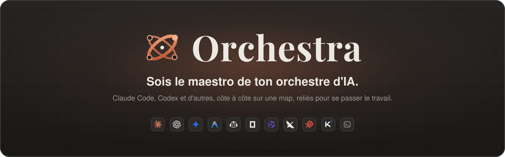
</p>

<p align="center">
  <b>Une grande map où tu poses des agents IA de code, chacun dans son vrai terminal,<br>et où tu les relies pour qu'ils se passent le travail.</b><br>
  <sub>Claude Code · Codex · Gemini CLI · Aider · et toute CLI que tu ajoutes &nbsp;·&nbsp; <a href="README.md">🇬🇧 Read in English</a></sub>
</p>

<p align="center">
  <a href="../../releases/latest"></a>
  &nbsp;
  <a href="../../releases/latest"></a>
</p>

<p align="center">
  <a href="#-télécharger"></a>
  <a href="#-nouveautés-de-la-013"></a>
  <a href="#-démos"></a>
  <a href="#-fonctionnalités"></a>
  <a href="#-tutoriel"></a>
  <a href="#-raccourcis-clavier"></a>
  <a href="#-confidentialité-et-sécurité"></a>
  <a href="#-faq"></a>
  <a href="#-compiler-depuis-les-sources"></a>
</p>

<p align="center">
  <a href="../../releases/latest"></a>
  <a href="../../releases"></a>
  <a href="../../stargazers"></a>
  
  
  <a href="LICENSE"></a>
</p>

<picture>
  <source media="(prefers-color-scheme: light)" srcset="docs/images/map-light.png">
  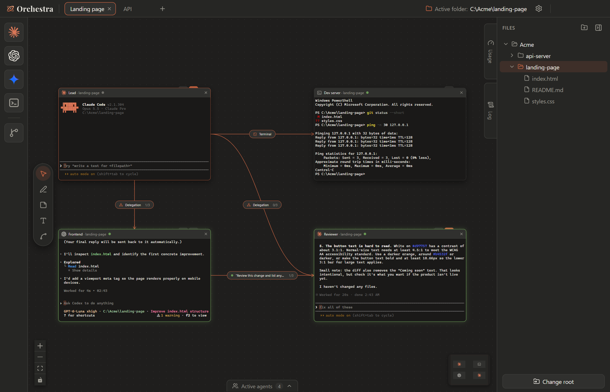
</picture>

> [!NOTE]
> Orchestra est un projet open source indépendant, sans lien avec Anthropic, OpenAI ou Google. Il lance seulement les CLI que tu utilises déjà, avec tes propres comptes, sur ta machine.

<p align="center"></p>

##  Pourquoi Orchestra

Tu utilises déjà Claude Code ou Codex dans un terminal. Orchestra en met autant que tu veux **côte à côte sur une map infinie**, chacun dans un vrai terminal, et te laisse **les relier**.

<table>
  <tr>
    <td width="33%" align="center" valign="top">
      <br>
      <b>1. Pose tes agents</b><br>
      <sub>Choisis un dossier dans l'explorateur et glisse Claude Code, Codex ou n'importe quelle CLI sur la map. Chaque case est un vrai terminal.</sub>
    </td>
    <td width="33%" align="center" valign="top">
      <br>
      <b>2. Relie-les</b><br>
      <sub>Trace un lien d'une case à l'autre : transmettre une réponse finie, laisser un chef déléguer, ou donner à un agent un terminal ou un post-it partagé.</sub>
    </td>
    <td width="33%" align="center" valign="top">
      <br>
      <b>3. Laisse-les travailler</b><br>
      <sub>Suis chaque échange dans le journal, réponds aux permissions au fil de l'eau, et reçois une lueur, un son et une notification quand un agent a fini.</sub>
    </td>
  </tr>
</table>

- Un agent **chef** peut **déléguer** des tâches à d'autres agents et récupérer leurs réponses lui-même.
- Un agent **Frontend** peut **transmettre** automatiquement son travail fini à un **relecteur**.
- Un agent peut **piloter un terminal que tu vois** (`npm run dev`, tests, build) au lieu de lancer des commandes cachées.

<p align="center"></p>

##  Nouveautés de la 0.1.3

<table>
  <tr>
    <td width="33%" align="center" valign="top">
      <br>
      <b>Tâches : séquences de prompts</b><br>
      <sub>Enregistre des étapes pour Claude Code et Codex. Orchestra envoie le prompt suivant quand l'agent précédent a fini, peut joindre sa réponse et attendre ta validation.</sub>
    </td>
    <td width="33%" align="center" valign="top">
      <br>
      <b>Modèles d'équipes</b><br>
      <sub>Démarre un tableau depuis <i>Développeur + relecteur</i>, <i>Chef + deux agents</i> ou <i>Développeur + terminal</i>, ou enregistre ton propre tableau comme modèle.</sub>
    </td>
    <td width="33%" align="center" valign="top">
      <br>
      <b>Blocages et encoche des permissions</b><br>
      <sub>Permissions en attente, échanges refusés et terminaux arrêtés au même endroit. Accepte ou refuse une permission simple sans ouvrir la case.</sub>
    </td>
  </tr>
</table>

**Tableaux**
- **Formations :** sélectionne des cases avec un rectangle au clic droit et range-les en grille, lignes, colonnes ou ligne droite, avec un aperçu en direct.
- **Groupes :** nomme un ensemble de cases, déplace-les ensemble, et retrouve-les dans les modèles d'équipes.
- **Annuler / rétablir** (`Ctrl+Z` / `Ctrl+Y`) pour les positions et les groupes.
- **Trouver une case** sur tous les tableaux (`Ctrl+Maj+F`) et **agrandir un terminal** sur toute la map (`Ctrl+Maj+M`).
- **Sauvegardes des tableaux :** jusqu'à 10 anciens workspaces, et un écran de récupération si `workspace.json` est illisible.

**Liens et agents**
- **Valider avant l'envoi** sur les liens Transmission : modifie, envoie ou abandonne le message préparé. Les messages en file s'annulent tant qu'ils ne sont pas remis.
- **Reprise exacte de la session** de chaque case Claude Code et Codex, même quand deux cases partagent un dossier.
- Onglet **Historique** dans Tâches : chaque message envoyé par un lien, avec sa réponse et les fichiers modifiés depuis le début de la tâche.
- **Diagnostic** dans les paramètres : où la commande de chaque agent a été trouvée, sa version et ses hooks Orchestra.
- Une nouvelle **personnalisation au premier lancement** : langue, thème, police des terminaux, grille, lueur et agents du dock, puis la visite guidée.

<sub>Historique complet : <a href="../../releases">versions</a></sub>

<p align="center"></p>

##  Démos

<p align="center">
  <b>Délégation</b><br>
  <sub>Un Claude chef demande une idée à un Claude et à un Codex, attend leurs deux réponses et en choisit une.</sub><br><br>
  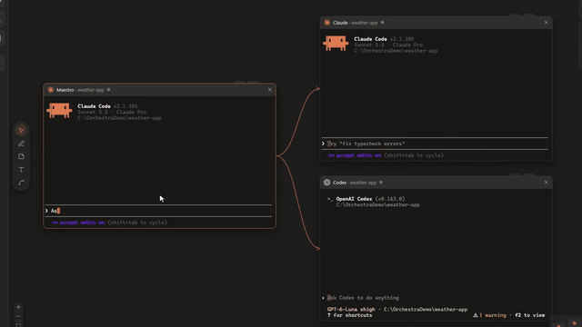
</p>

<table>
  <tr>
    <td width="50%" align="center" valign="top">
      <b>Poser un agent</b><br>
      <sub>Glisse-le depuis le dock : il démarre dans le dossier actif.</sub><br><br>
      
    </td>
    <td width="50%" align="center" valign="top">
      <b>Relier deux agents</b><br>
      <sub>Outil Lien, première case, deuxième case, puis le type.</sub><br><br>
      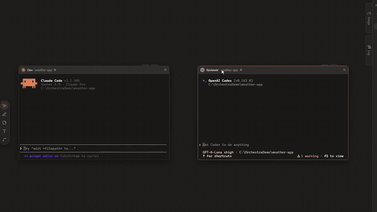
    </td>
  </tr>
  <tr>
    <td width="50%" align="center" valign="top">
      <b>Transmission</b><br>
      <sub>Quand un agent a fini, sa réponse descend le lien.</sub><br><br>
      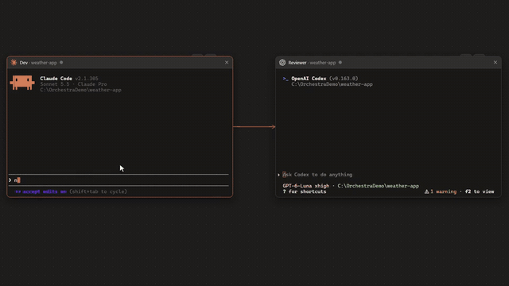
    </td>
    <td width="50%" align="center" valign="top">
      <b>Un terminal piloté par l'agent</b><br>
      <sub>Il lance la commande là où tu la vois, lit la sortie et peut l'arrêter.</sub><br><br>
      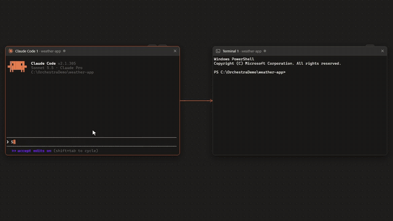
    </td>
  </tr>
  <tr>
    <td width="50%" align="center" valign="top">
      <b>Donner un rôle</b><br>
      <sub>Une consigne durable, redonnée à chaque début de session.</sub><br><br>
      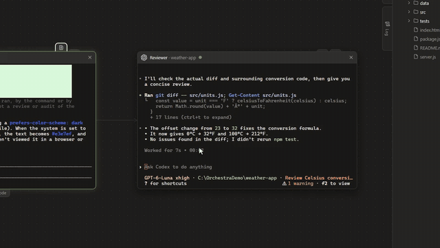
    </td>
    <td width="50%" align="center" valign="top">
      <b>Changer de branche</b><br>
      <sub>Glisse le carré Branche sur une case : l'agent passe dans son propre worktree.</sub><br><br>
      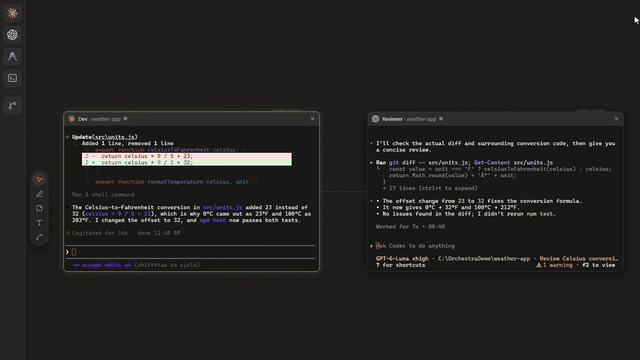
    </td>
  </tr>
</table>

<p align="center"></p>

##  Fonctionnalités

<table>
  <tr>
    <td width="33%" valign="top">&nbsp;<b>Map infinie</b><br><sub>Déplacement, zoom, minicarte, plusieurs tableaux en onglets. Les agents continuent en arrière-plan.</sub></td>
    <td width="33%" valign="top">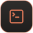&nbsp;<b>Vrais terminaux</b><br><sub>xterm.js + node-pty, lancés dans le dossier choisi dans l'explorateur.</sub></td>
    <td width="33%" valign="top">&nbsp;<b>Liens entre agents</b><br><sub>Transmission, Délégation, Terminal et Note, avec une limite de tours contre les boucles.</sub></td>
  </tr>
  <tr>
    <td valign="top">&nbsp;<b>Tâches</b><br><sub>Séquences de prompts entre agents, et l'historique de chaque échange.</sub></td>
    <td valign="top">&nbsp;<b>Modèles d'équipes</b><br><sub>Des équipes toutes prêtes, ou ton tableau gardé pour la prochaine fois.</sub></td>
    <td valign="top">&nbsp;<b>Rôles</b><br><sub>« Tu es le relecteur, tu ne modifies jamais de fichier… », gardé d'une session à l'autre.</sub></td>
  </tr>
  <tr>
    <td valign="top">&nbsp;<b>Journal des échanges</b><br><sub>Messages, réponses, commandes et refus, avec filtres et export JSON.</sub></td>
    <td valign="top">&nbsp;<b>Changements</b><br><sub>Diff coloré du worktree, ou depuis le début d'une tâche. Ouverture dans VS Code.</sub></td>
    <td valign="top">&nbsp;<b>Branches Git</b><br><sub>Passe un agent sur une autre branche, dans son propre <code>git worktree</code>.</sub></td>
  </tr>
  <tr>
    <td valign="top">&nbsp;<b>Boîte des blocages</b><br><sub>Permissions en attente, refus et terminaux arrêtés, tous tableaux confondus.</sub></td>
    <td valign="top">&nbsp;<b>Statuts et notifications</b><br><sub>Travaille, attend ou a fini, avec une lueur, un son et une notification du système.</sub></td>
    <td valign="top">&nbsp;<b>Thèmes</b><br><sub>Standard, Clair, ChatGPT, Gemini, VS Code, GitHub, Dracula, Nord, ta couleur d'accent. Anglais et français.</sub></td>
  </tr>
</table>

<p align="center"></p>

##  Télécharger

<table>
  <tr>
    <td width="50%" align="center" valign="top">
      <b>Windows 10 / 11</b><br>
      <sub>Installateur 64 bits</sub><br><br>
      <a href="../../releases/latest"></a>
      <p align="left">
        ✓ &nbsp;Lance <code>Orchestra-Setup-&lt;version&gt;.exe</code><br>
        ✓ &nbsp;Choix du dossier, raccourcis bureau et menu Démarrer<br>
        ✓ &nbsp;Recherche et installation des mises à jour intégrées
      </p>
    </td>
    <td width="50%" align="center" valign="top">
      <b>macOS</b><br>
      <sub>Apple Silicon (<code>arm64</code>) et Intel (<code>x64</code>)</sub><br><br>
      <a href="../../releases/latest"></a>
      <p align="left">
        ✓ &nbsp;Ouvre le <code>.dmg</code> et glisse Orchestra dans Applications<br>
        ✓ &nbsp;Premier lancement : clic droit sur Orchestra, puis <b>Ouvrir</b><br>
        ✓ &nbsp;Recherche des mises à jour intégrée
      </p>
    </td>
  </tr>
</table>

> [!IMPORTANT]
> Il te faut les CLI d'agents que tu veux utiliser, installées et connectées : [`claude`](https://docs.anthropic.com/en/docs/claude-code) et/ou [`codex`](https://github.com/openai/codex) doivent marcher dans un terminal normal.

> [!NOTE]
> L'app n'est pas encore signée. Sous Windows, SmartScreen peut afficher « Windows a protégé votre ordinateur » : clique sur **Informations complémentaires → Exécuter quand même**. Sous macOS, fais clic droit → **Ouvrir** la première fois.

<p align="center"></p>

##  Tutoriel

### Premier lancement

Orchestra te demande quelques choix rapides (langue, thème, police des terminaux, grille, lueur et agents affichés dans le dock), puis propose une visite guidée d'une minute sur ton propre tableau. **Passer** mène directement à la visite. Les deux se refont depuis **Paramètres › Général**.

<p align="center">
  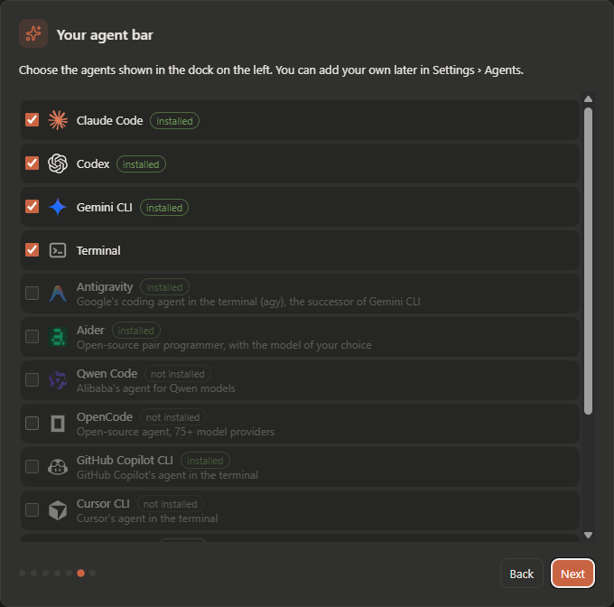
  &nbsp;
  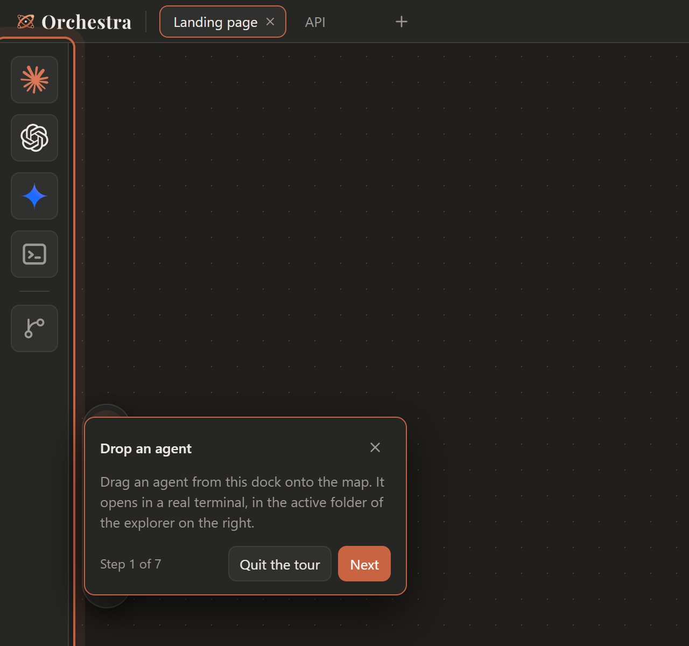
</p>

<sub>Les captures de l'interface sont en anglais, la langue par défaut ; l'app passe en français dans les paramètres.</sub>

### 1. Pose tes agents

1. Dans l'**explorateur** à droite, clique sur le dossier où tu veux travailler : il devient le *dossier actif*.
2. **Glisse un agent** du dock de gauche sur la map. Il démarre dans un vrai terminal, dans le dossier actif.
3. Pose-en un deuxième. Chaque case se déplace, se redimensionne (clic sur sa barre de titre d'abord) et se renomme (double-clic sur son nom).

### 2. Relie-les

Prends l'**outil Lien** (`L`), clique sur la première case, puis sur la deuxième. Avec l'**outil Sélection** (`V`), clique sur l'étiquette au milieu du lien pour choisir comment ils se parlent :

<p align="center">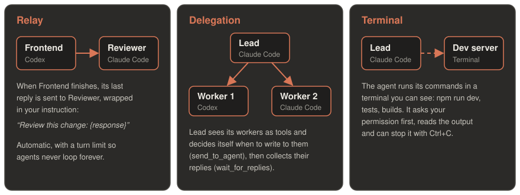</p>

| Lien | Ce qui se passe | Idéal pour |
|---|---|---|
| **Transmission** | Quand A a fini, sa dernière réponse est collée dans B avec ta consigne (`{response}` est remplacé par la réponse). | Dev → relecteur, rédacteur → traducteur |
| **Délégation** | A envoie une tâche avec un identifiant unique. Les demandes vers un même agent sont mises en file ; chaque réponse revient à son émetteur. | Un chef qui répartit le travail |
| **Terminal** | A lance des commandes dans une case Terminal que tu vois, après t'avoir demandé la permission. | Serveurs de dev, tests, build |
| **Note** | A lit et met à jour un post-it relié (`list_notes`, `read_note`, `write_note`). | Plans partagés, listes, observations |

Les liens Transmission et Délégation peuvent être inversés ou mis dans les deux sens, avec une **limite de tours** (3 par défaut).

<p align="center">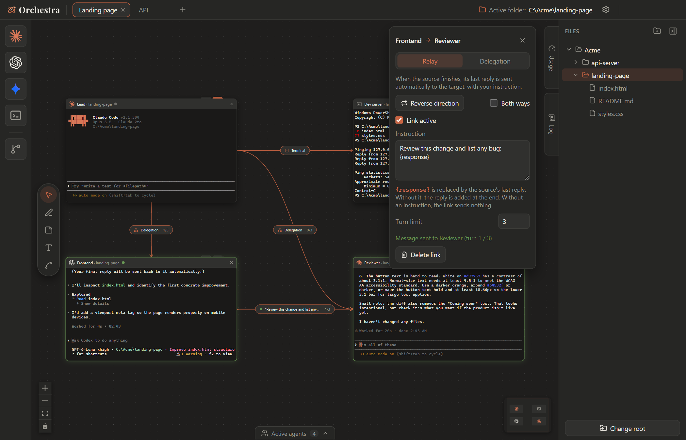</p>

<details>
<summary><b>Valider avant l'envoi et messages en file</b></summary>

Coche **Valider avant l'envoi** sur une Transmission pour garder la main : quand la source a fini, le message est préparé mais pas envoyé. Modifie-le, envoie-le ou abandonne-le depuis le panneau du lien ou le Journal. Quand l'étiquette du lien est visible, elle s'agrandit avec un court aperçu et les boutons **Envoyer / Abandonner** ; avec plusieurs brouillons, elle présente le plus ancien et indique combien restent.

Les messages en file (Transmission ou Délégation, en attente d'une cible occupée) s'annulent tant qu'ils ne sont pas collés ; une délégation annulée prévient son émetteur au lieu de le laisser attendre. Un message déjà remis ne peut pas être rappelé.
</details>

### 3. Donne un rôle

Survole la petite encoche au-dessus d'une case Claude Code ou Codex et clique sur le **masque**. Le rôle est donné à l'agent au début de chaque session (et de nouveau après `/clear`). L'éditeur montre aussi le texte donné à la session en cours. Un rôle est une consigne, pas une restriction des outils de l'agent.

<p align="center">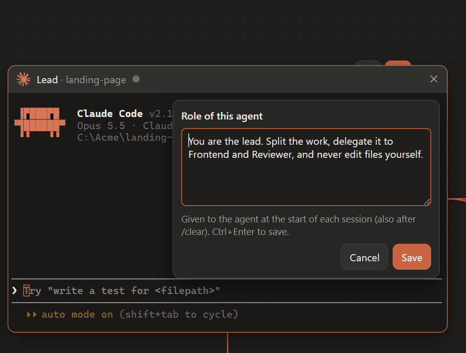</p>

### 4. Partage un post-it

Pose un post-it et relie un agent à celui-ci. Demande à l'agent de le lire ou de le modifier ; tu vois les changements sur la map et tu peux l'éditer toi-même. Les lignes `- [ ] À faire`, `- [~] En cours` et `- [x] Fait` affichent des icônes de statut. Une écriture remplace toute la note : l'agent doit la lire d'abord.

### 5. Suis les échanges

Ouvre le **Journal** sur le bord droit de la map (`Ctrl+Maj+J`) : messages transmis, tâches déléguées et leurs réponses, commandes du terminal et leur sortie, et refus en rouge. Chaque message affiche son état (*à valider*, *en attente*, *envoyé*, *réponse reçue*, *annulé*, *refusé*). **Filtres** restreint par tableau, case et type ; clique sur un identifiant (`#1a2b3c4d`) pour suivre une seule tâche. **Exporter le journal** enregistre la liste filtrée en JSON. Le journal reste en mémoire uniquement.

<p align="center">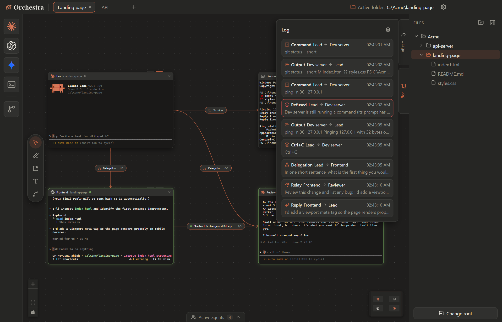</p>

### 6. Réponds aux permissions

Quand un agent t'attend, une **encoche** sort de l'icône de réception dans la barre du haut. Pour une permission simple (oui / non), **Accepter** ou **Refuser** directement ; pour une question ou un plan, elle t'emmène au terminal. La **boîte de réception des blocages** liste aussi les échanges refusés, les limites de tours et les terminaux arrêtés, tous tableaux confondus.

### 7. Relis les changements

Quand une case travaille dans un dépôt Git, une encoche au-dessus d'elle ouvre la fenêtre **Changements** : chaque fichier modifié de son worktree avec un diff coloré, et **Ouvrir dans VS Code**. Les autres cases du même worktree sont listées, car les changements d'un dossier partagé ne peuvent pas être attribués à un seul agent. Ici, Orchestra ne fait que lire Git.

<p align="center">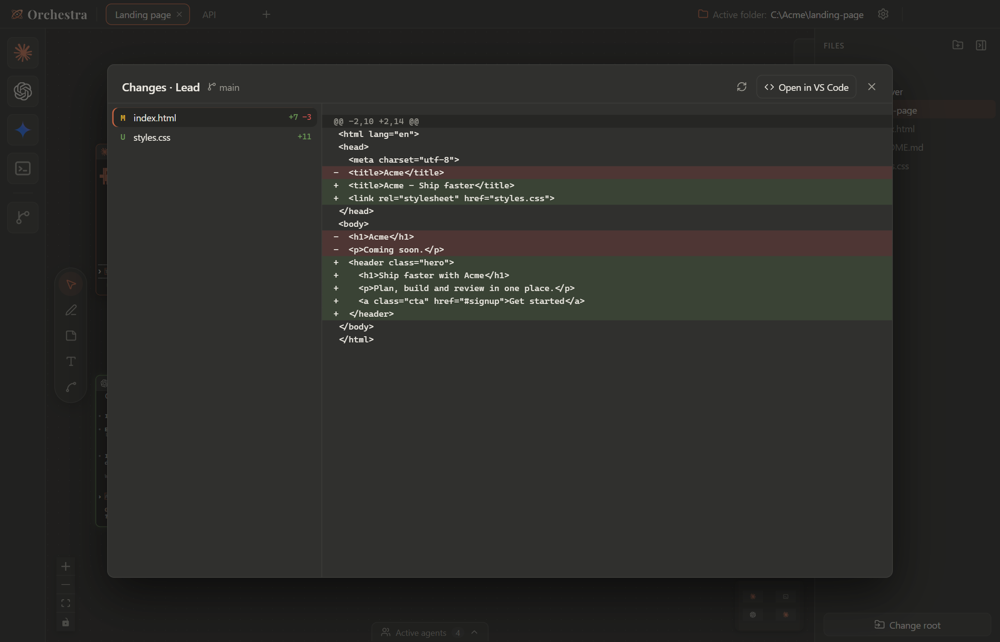</p>

### 8. Reprends et récupère

Claude Code et Codex reprennent la session exacte sauvegardée pour chaque case. Si une session est introuvable, Orchestra propose une nouvelle discussion au lieu de reprendre celle d'une autre case. **Paramètres › Général › Sauvegardes des tableaux** garde jusqu'à 10 anciens workspaces ; si `workspace.json` est illisible au démarrage, choisis une sauvegarde ou un nouveau tableau.

<p align="center"></p>

##  Recettes

**Un chef et deux agents.** Place un Claude Code *Chef* au-dessus d'un Codex et d'un Claude Code, reliés en **Délégation**. Demande au chef : *« Demande un court poème à chacun de tes agents et dis-moi lequel est le meilleur. »* Il écrit aux deux, attend leurs réponses et te répond. (Aussi disponible en modèle d'équipe.)

**Dev + relecteur.** Relie un agent *Frontend* à un *Relecteur* par une **Transmission** avec la consigne *« Relis ce changement et liste les bugs : {response} »*. Donne au relecteur le rôle *« Tu ne modifies jamais de fichier. »* Chaque fois que l'agent frontend a fini, le relecteur vérifie son travail.

**Un agent qui lance ton serveur de dev.** Relie un agent à une case **Terminal**, puis demande : *« Lance le serveur de dev dans le terminal relié et dis-moi quand il est prêt. »* Tu vois la commande tourner ; l'agent lit la sortie et peut l'arrêter avec Ctrl+C.

**Une séquence préparée.** Ouvre **Tâches**, crée une tâche avec une étape pour ton développeur et une étape pour ton relecteur avec *Joindre la réponse précédente*, puis clique sur **Lancer**. Voir le [guide des séquences](docs/task-sequences.md).

<p align="center">
  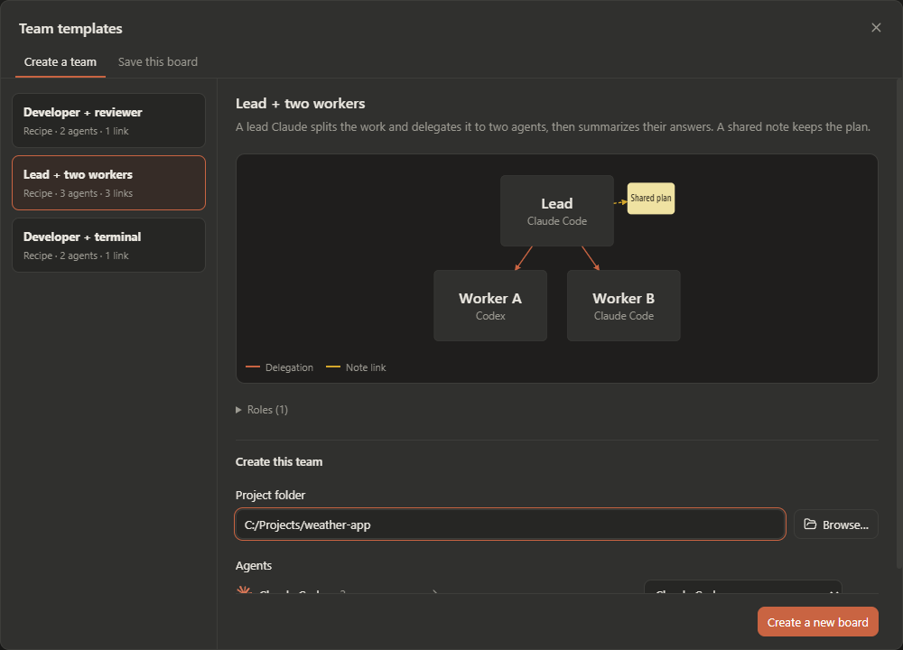
  &nbsp;
  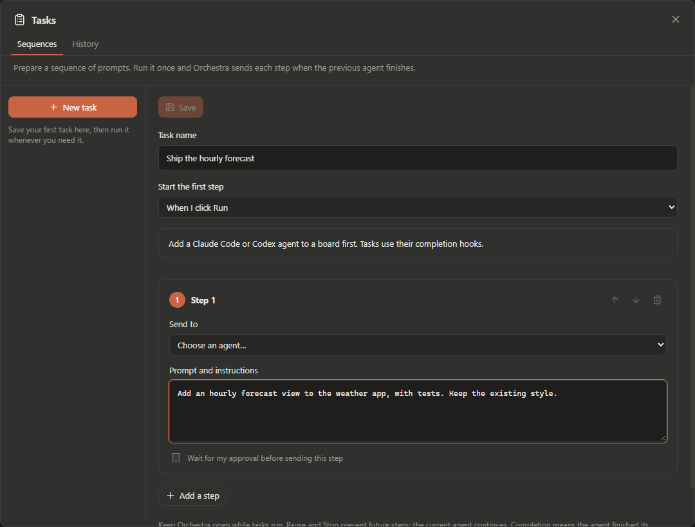
</p>

<details>
<summary><b>Plus : Tâches, Historique, formations, groupes et modèles d'équipes en détail</b></summary>

**Tâches › Séquences.** Une tâche est une suite de prompts enregistrée. Orchestra attend chaque réponse avant d'envoyer la suivante, au même agent ou à un autre. Elle part au clic sur **Lancer** ou quand un agent précis a fini ; une étape peut joindre la réponse précédente ou attendre ta validation. Pause, reprise ou arrêt à tout moment ; l'agent en cours finit toujours sa réponse. Les séquences sont dans `task-sequences.json` (50 tâches, 50 étapes chacune).

**Tâches › Historique.** Chaque message envoyé entre agents par un lien, avec sa réponse et les fichiers modifiés depuis le début. Lis la réponse, puis marque le résultat comme terminé ou en échec. Tu peux aussi **Suivre une tâche** que tu donnes toi-même à un agent. **Fichiers modifiés depuis le début** compare le worktree à une image prise au début du travail, sans commit ni stash. Ces images restent locales et sont limitées (20 références, 500 fichiers chacune, 200 Ko par fichier).

**Formations et groupes.** Sélectionne plusieurs cases avec un rectangle au clic droit, puis ouvre **Formation** : grille adaptative, 3 ou 4 par ligne, 2 colonnes, ligne horizontale ou colonne centrée. Survole une formation pour la prévisualiser ; `Ctrl+Z` l'annule. Crée un groupe nommé depuis la sélection : glisse son nom pour déplacer ses cases, double-clique pour le renommer, ou dégroupe sans fermer les cases.

**Modèles d'équipes.** Choisis le dossier du projet et remplace un agent indisponible par un agent installé, puis crée un nouveau tableau. Rôles et liens sont enregistrés avant le démarrage des agents. Chaque instance a ses propres cases et sessions. Les modèles enregistrés sont dans `team-templates.json`.

**Barre du haut.** Tâches, Rechercher, Équipes, Réception et Paramètres sont des icônes compactes. Pour afficher leur nom au survol, active **Paramètres › Apparence › Agrandir les boutons de la barre au survol**.
</details>

<p align="center"></p>

##  Raccourcis clavier

<table>
  <tr>
    <td width="50%" valign="top">

**Partout (même dans un terminal)**

| | |
|---|---|
| <kbd>Ctrl</kbd>+<kbd>Tab</kbd> / <kbd>Ctrl</kbd>+<kbd>Maj</kbd>+<kbd>Tab</kbd> | Tableau suivant / précédent |
| <kbd>Ctrl</kbd>+<kbd>1…9</kbd> | Aller au tableau |
| <kbd>Ctrl</kbd>+<kbd>Maj</kbd>+<kbd>T</kbd> | Nouveau tableau |
| <kbd>Ctrl</kbd>+<kbd>,</kbd> | Paramètres |
| <kbd>Ctrl</kbd>+<kbd>Maj</kbd>+<kbd>E</kbd> / <kbd>A</kbd> / <kbd>U</kbd> / <kbd>J</kbd> | Fichiers / agents actifs / utilisation / journal |
| <kbd>Ctrl</kbd>+<kbd>Maj</kbd>+<kbd>F</kbd> | Trouver une case sur tous les tableaux |
| <kbd>Ctrl</kbd>+<kbd>Maj</kbd>+<kbd>M</kbd> | Agrandir ou rétablir le terminal choisi |

</td>
    <td width="50%" valign="top">

**Sur la map**

| | |
|---|---|
| <kbd>V</kbd> <kbd>P</kbd> <kbd>N</kbd> <kbd>T</kbd> <kbd>L</kbd> | Sélection, stylo, post-it, texte, lien |
| <kbd>F</kbd> | Tout afficher |
| <kbd>Suppr</kbd> | Supprimer la sélection (avec confirmation) |
| <kbd>F2</kbd> | Renommer la case choisie |
| <kbd>Ctrl</kbd>+<kbd>Z</kbd> / <kbd>Ctrl</kbd>+<kbd>Y</kbd> | Annuler / rétablir |

</td>
  </tr>
</table>

Dans un terminal, <kbd>Ctrl</kbd>+<kbd>C</kbd> copie quand du texte est sélectionné (sinon il interrompt) et <kbd>Ctrl</kbd>+<kbd>V</kbd> colle. La liste complète est dans **Paramètres › Raccourcis**.

<p align="center">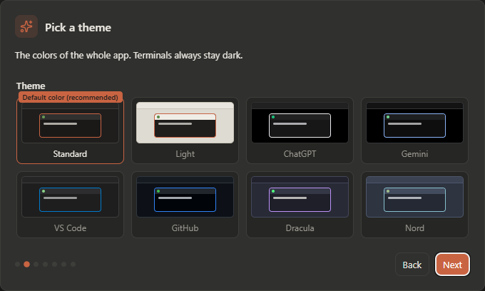</p>

<p align="center"></p>

##  Confidentialité et sécurité

<table>
  <tr>
    <td width="50%" valign="top">
      <b>🔒 Orchestration locale</b><br>
      <sub>Les agents parlent à Orchestra par un petit serveur limité à <code>127.0.0.1</code>, protégé par un jeton secret qui change à chaque lancement. La recherche de mises à jour contacte GitHub (désactivable dans Paramètres › Général). Les fetch Git et les CLI des agents utilisent leurs propres connexions.</sub>
    </td>
    <td width="50%" valign="top">
      <b>✋ Tes permissions restent les tiennes</b><br>
      <sub>Orchestra n'approuve jamais une permission tout seul. Ses propres outils sont pré-autorisés, sauf <code>run_in_terminal</code>, qui demande toujours. L'encoche n'envoie que ton Accepter ou ton Refuser.</sub>
    </td>
  </tr>
  <tr>
    <td valign="top">
      <b>🌿 Git, surtout en lecture</b><br>
      <sub>Seulement <code>git fetch</code>, <code>git worktree add</code> (quand tu choisis une branche) et des commandes de lecture. Orchestra ne fait jamais de commit ni de push.</sub>
    </td>
    <td valign="top">
      <b>📁 Ce qu'il écrit hors de son dossier</b><br>
      <sub><code>~/.claude.json</code> : marque un dossier comme accepté avant d'y lancer Claude Code (désactivable). <code>~/.codex/orchestra.config.toml</code> et les entrées d'Orchestra dans <code>~/.codex/hooks.json</code>, inactifs hors d'Orchestra.</sub>
    </td>
  </tr>
</table>

Les données de l'app (paramètres, tableaux, tâches, modèles) sont dans `%APPDATA%\Orchestra` (macOS : `~/Library/Application Support/Orchestra`). Le journal des échanges et la boîte des blocages restent en mémoire uniquement.

<p align="center"></p>

##  FAQ

<details>
<summary><b>Codex me demande d'approuver « 5 hooks »</b></summary>

Ce sont les hooks de statut d'Orchestra (travaille / a fini). Choisis **Trust all and continue** une fois ; Codex s'en souvient.
</details>

<details>
<summary><b>Quels agents peuvent utiliser les liens ?</b></summary>

Claude Code et Codex peuvent transmettre, déléguer, piloter un terminal, utiliser les post-it reliés et suivre des séquences de tâches. Les autres CLI (Aider, Gemini CLI, les tiennes…) marchent dans une case et peuvent *recevoir* des messages transmis ; leur intégration ne comprend pas les hooks ni les outils d'orchestration d'Orchestra.
</details>

<details>
<summary><b>Puis-je ajouter une autre CLI ?</b></summary>

Oui : **Paramètres › Agents**. Choisis un agent connu (Google Antigravity, Aider, Qwen Code, OpenCode, GitHub Copilot CLI, Cursor CLI, Goose, Amp, Kimi CLI…) ou ajoute ta propre commande, ton logo et ta couleur. *Tester* vérifie que la commande existe, et **Paramètres › Diagnostic** montre où elle a été trouvée.
</details>

<details>
<summary><b>Un agent semble bloqué</b></summary>

Regarde l'icône de réception dans la barre du haut : l'agent attend peut-être une permission ou une réponse. La boîte des blocages montre aussi les limites de tours atteintes et les échanges refusés. **Paramètres › Diagnostic** indique si l'agent a les hooks d'Orchestra et quel hook il a envoyé en dernier.
</details>

<details>
<summary><b>Linux ?</b></summary>

Orchestra marche sous Windows et macOS (Apple Silicon et Intel), avec un installateur pour chacun dans chaque version. Linux n'est pas encore testé ni empaqueté.
</details>

<p align="center"></p>

##  Compiler depuis les sources

Utilise Node.js 22.12+. Installe les dépendances verrouillées avec `npm ci`.

```bash
npm ci           # node-pty fournit ses binaires précompilés : ni Visual Studio ni Python
npm run dev      # Vite + Electron avec rechargement à chaud
npm test         # tests des sessions, de la récupération, des files, de la validation, de l'annulation et du diagnostic
npm run dist     # installateur Windows dans release/Orchestra-Setup-<version>.exe
```

La version macOS vit sur la branche `macbook` : `npm run dist:mac` y construit les `.dmg` (sur un Mac), et chaque push sur cette branche les construit sur GitHub Actions.

<details>
<summary><b>Lanceur Windows et remarques de build</b></summary>

`launcher.exe` à la racine reconstruit l'interface et prépare un `Orchestra.exe` local avec l'icône et les métadonnées d'Orchestra (`npm run build:launcher` recompile le lanceur ; `npm run build:runtime` prépare l'exécutable). L'exécutable Electron d'origine reste inchangé. La copie renommée ajoute environ 250 Mo dans `node_modules` (ignoré) et resservira tant qu'Electron, l'icône ou la version ne changent pas. Ferme l'app avant d'appliquer une mise à jour de l'exécutable.

Si la protection contre les ransomwares de Windows (*Dossiers contrôlés*) est active et que le projet est dans `Documents`, elle peut bloquer la création de l'installateur : autorise `makensis.exe` ou compile ailleurs.
</details>

<details>
<summary><b>Structure du projet</b></summary>

```
electron/            côté Node : fenêtres, terminaux, fichiers, serveur local, MCP
  main.cjs           fenêtre, routes IPC, notifications
  preload.cjs        le seul pont vers l'interface (window.pty, fs, settings, workspace, git…)
  ptyManager.cjs     un vrai PTY par case
  hookServer.cjs     serveur local (127.0.0.1 + jeton) pour les hooks et les outils MCP
  mcpServer.cjs      le serveur MCP « orchestra » lancé par chaque agent (stdio)
  linkRelay.cjs      liens Transmission
  delegation.cjs     liens Délégation (list_agents, send_to_agent, wait_for_replies)
  terminalLink.cjs   liens Terminal (run_in_terminal, read_terminal, interrupt_terminal)
  activityLog.cjs    journal des échanges (en mémoire)
  agentStatus.cjs    statut des cases et demandes de permission
  claudeHooks.cjs    réglages et config MCP de chaque case Claude Code
  codexProfile.cjs   profil et hooks Codex
  git.cjs            branches, worktrees, changements et diffs en lecture seule
src/                 interface React (map, cases, panneaux, paramètres, tutoriel)
docs/images/         images, démos et visuels du README
```

Le trajet d'une frappe : xterm.js → `window.pty.write` → IPC → node-pty → la CLI, et retour par `pty:data:<id>`.
</details>

<p align="center"></p>

##  Retours et aide

<p align="center">
  <b>Un bug ou une idée ?</b><br>
  <a href="../../issues/new/choose">Ouvre une issue</a> (un court formulaire pour les bugs, un pour les idées) ou raconte comment tu utilises Orchestra dans les <a href="../../discussions">Discussions</a>.<br>
  <sub>Pour tout le reste : <b>orchestraboardai [at] gmail [dot] com</b></sub>
</p>

<p align="center">
  Si Orchestra te fait gagner du temps, une ⭐ sur le dépôt aide d'autres personnes à le trouver.
</p>

##  Licence

[MIT](LICENSE) © 2026 Dimitri ([@Adoraay](https://github.com/Adoraay))
