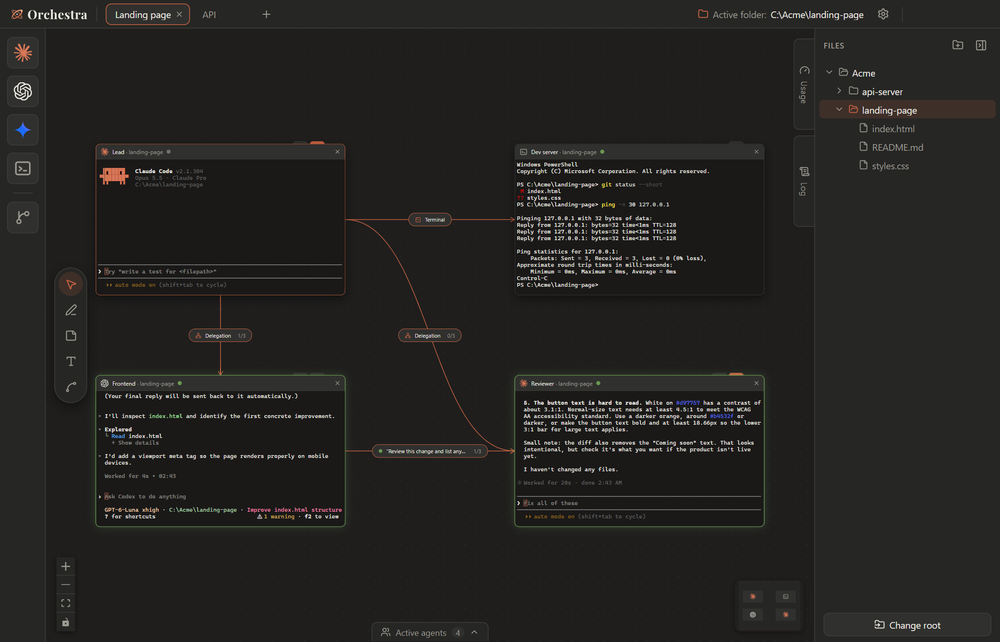
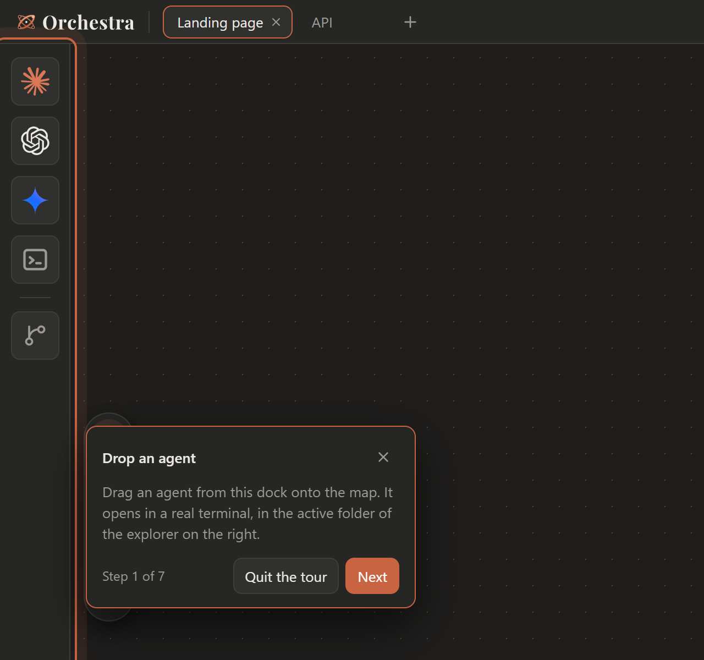
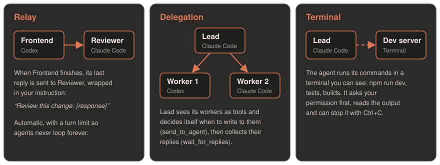
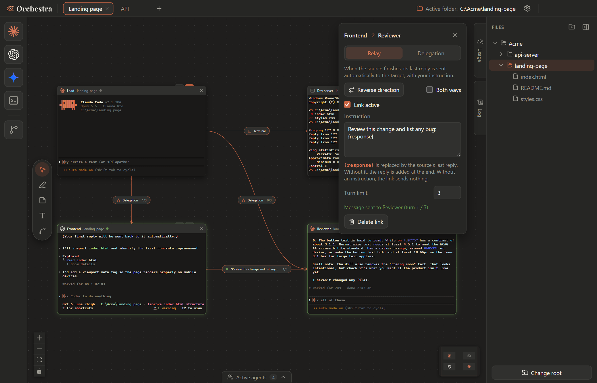
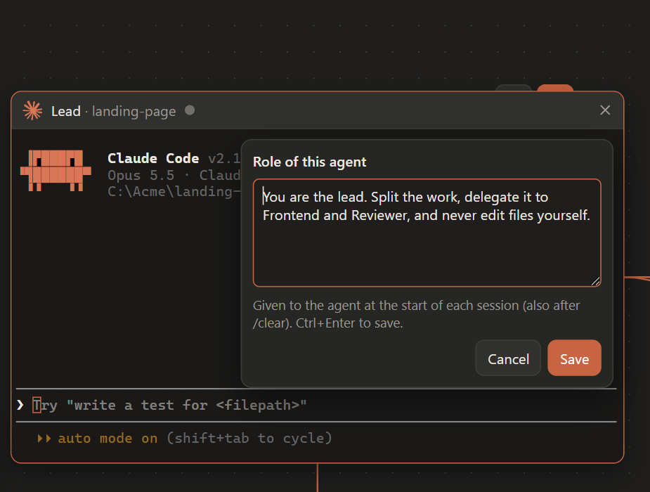
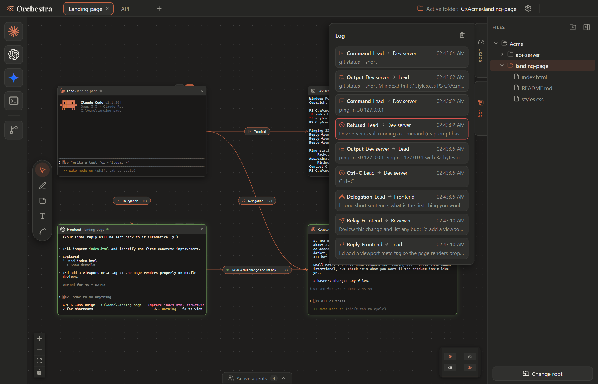
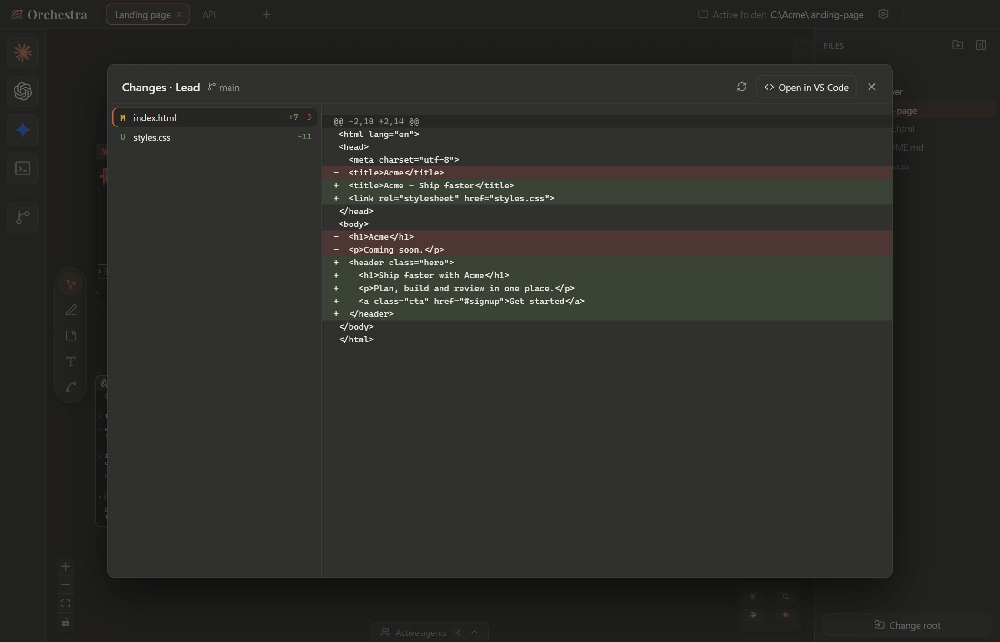
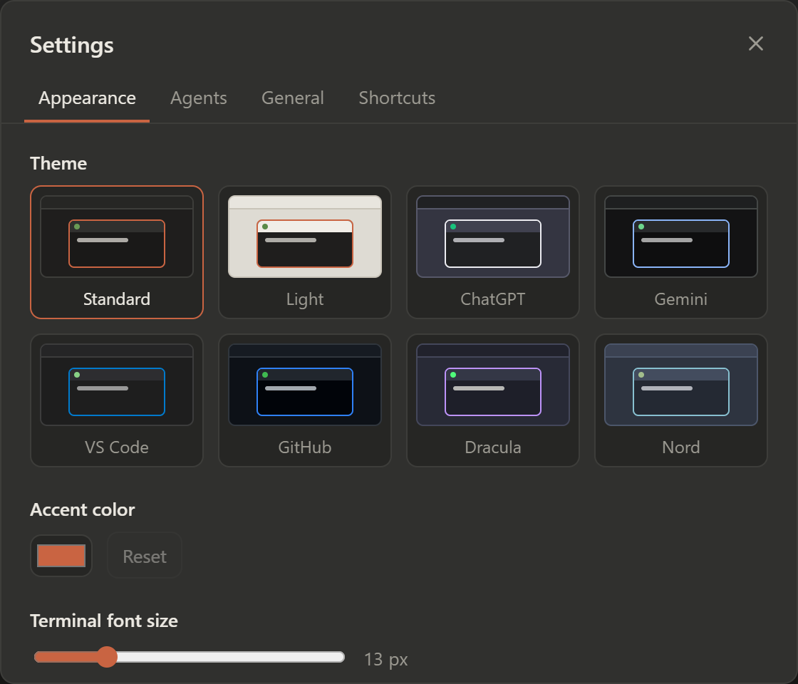

<p align="center">
  <picture>
    <source media="(prefers-color-scheme: dark)" srcset="src/assets/orchestra-lockup.svg">
    
  </picture>
</p>

<p align="center"><b>Be the maestro of your AI orchestra.</b></p>

<p align="center">
  A big canvas where you drop AI coding agents (Claude Code, Codex…), each in its own real terminal,<br>
  and wire them together so they hand work to each other.
</p>

<p align="center">
  <a href="../../releases/latest"></a>
  
  <a href="LICENSE"></a>
</p>

<p align="center"><a href="README.fr.md">🇫🇷 Lire en français</a></p>

<picture>
  <source media="(prefers-color-scheme: light)" srcset="docs/images/map-light.png">
  
</picture>

<!-- GIF à ajouter ici : docs/images/demo.gif (glisser deux agents, les relier, un message qui passe) -->

## What is Orchestra?

You already run Claude Code or Codex in a terminal. Orchestra puts as many of them as you want **side by side on an infinite map**, each one in a real terminal, and lets you **link them**:

- a **Lead** agent can **delegate** tasks to other agents and collect their answers by itself,
- a **Frontend** agent can **relay** its finished work to a **Reviewer** automatically,
- an agent can **drive a terminal you can see** (`npm run dev`, tests, builds) instead of running hidden commands.

Everything stays on your machine. Orchestra only starts the CLIs you already use, with your own accounts.

## Features

| | |
|---|---|
| 🗺️ **Infinite map** | Drag agents from the dock onto a canvas with pan, zoom and minimap. Several boards in tabs; agents keep running in the background. |
| 💻 **Real terminals** | Every tile is a real terminal (xterm.js + node-pty), started in the folder you picked in the file explorer. |
| 🔗 **Links between agents** | **Relay** (automatic hand-off), **Delegation** (an agent talks to other agents through tools) and **Terminal** (an agent runs commands in a visible terminal). Turn limits prevent endless loops. |
| 🎭 **Roles** | Give each agent a lasting role (“You are the reviewer, you never edit files…”). |
| 📜 **Exchange log** | See every message, reply, command and refusal that went through a link. |
| 🔍 **Changes** | Review the files an agent changed, with a colored diff, and open them in VS Code. |
| 🌿 **Git branches** | Drop the *Branch* square on a tile to move its agent to another branch, in its own `git worktree`. |
| 🟢 **Status & notifications** | Working / waiting for permission / done, with a green glow, a sound and a system notification when an agent finishes. |
| 🎨 **Themes** | Standard, Light, ChatGPT, Gemini, VS Code, GitHub, Dracula and Nord, plus your own accent color. English and French. |
| 🧭 **Guided tour** | A one-minute tutorial on first launch, available again in the settings. |

## Getting started

### 1. Install

Download the installer for your system from the [latest release](../../releases/latest):

- **Windows:** run **`Orchestra-Setup-<version>.exe`**. Windows may say *“Windows protected your PC”* (the app is not code-signed yet): click **More info → Run anyway**.
- **macOS:** open the **`.dmg`** (`arm64` for Apple Silicon, `x64` for Intel) and drag Orchestra to Applications. The app is not signed by Apple yet: the first time, right-click Orchestra in Applications and choose **Open**.

**Requirements:** Windows 10 or 11 (64-bit) or macOS (Apple Silicon or Intel), and the agent CLIs you want to use, installed and logged in: [`claude`](https://docs.anthropic.com/en/docs/claude-code) and/or [`codex`](https://github.com/openai/codex) must work in a normal terminal.

### 2. Take the tour

On first launch, Orchestra offers a short guided tour. It walks you through everything below, on your own board.

<p align="center"></p>

## Tutorial

### Drop your agents

1. In the **file explorer** on the right, click the folder you want to work in: it becomes the *active folder*.
2. **Drag an agent** from the dock on the left onto the map. It starts in a real terminal, in the active folder.
3. Drop a second one. Each tile can be moved, resized (click its title bar first) and renamed (double-click its name).

<!-- GIF à ajouter ici : docs/images/drag-drop.gif (glisser Claude Code puis Codex depuis le dock) -->

### Link them

Pick the **Link tool** (`L`) in the toolbar, click the first tile, then the second one. Then, with the **Select tool** (`V`), click the label in the middle of the link to choose how they talk:

<p align="center"></p>

| Link | What happens | Good for |
|---|---|---|
| **Relay** | When A finishes, its last reply is pasted into B with your instruction (`{response}` is replaced by the reply). | Dev → reviewer, writer → translator |
| **Delegation** | A sends a task with a unique ID. Requests to the same agent are queued in order; each reply goes back to its caller. | A lead that splits work between several agents |
| **Terminal** | A runs commands in a Terminal tile you can watch, after asking your permission. | Dev servers, tests, builds |
| **Note** | A reads and updates a linked sticky note through `list_notes`, `read_note` and `write_note`. | Shared plans, checklists and findings |

Relay and Delegation links can be reversed or made two-way, and have a **turn limit** (3 by default). Terminal and Note links point from an agent to their target.

Tick **Review before sending** on a Relay link to stay in control: when the source finishes, the message is prepared but not sent. Edit it, send it or discard it from the link panel or the Log. Queued messages (Relay or Delegation, waiting for a busy target) can be cancelled there too until they are pasted; a cancelled delegation tells its caller instead of leaving it waiting. A message already delivered cannot be recalled.

When the link label is visible, it expands to show a short preview and **Send / Discard** buttons. With several drafts, it presents the oldest first and shows how many remain. Click its heading to open the link panel and edit the full message. If the tiles are too close to display a label, use the link panel or Log.

<p align="center"></p>

<!-- GIF à ajouter ici : docs/images/relay.gif (un agent termine, le point lumineux descend le lien, l'autre reçoit le message) -->

### Give a role

Hover the small tab peeking above a Claude Code or Codex tile and click the **mask**. The role is given to the agent at the start of each session (and again after `/clear`). A tile with a role shows an orange tab.

<p align="center"></p>

### Share a note

Drop a sticky note on the map and link an agent to it. This creates a Note link. Ask the agent to read or update the note; you see the changes on the map and can edit it yourself. Lines such as `- [ ] To do`, `- [~] In progress` and `- [x] Done` show status icons. A write replaces the entire note, so agents should read it before updating it.

### Resume and recover your boards

Claude Code and Codex resume the exact session saved for each tile, including when two tiles use the same folder. If the saved session or its transcript is missing, Orchestra asks you to start a new conversation instead of resuming another tile's discussion. Older workspaces without saved session IDs also require a new conversation for these agents. Other CLIs keep their own resume behavior.

**Settings › General › Board backups** lists up to 10 previous workspaces, kept locally at most once per minute while saving. Restoring closes all terminals, replaces every board and reloads the interface; the current readable workspace is backed up first. If `workspace.json` is unreadable at startup, choose a backup or a new board: the unreadable file is preserved separately before replacement. Backups include notes, paths, roles and session references; the agents keep their conversation files separately. No exchange log is included.

### Follow the exchanges

Open the **Log** tab on the right edge of the map (`Ctrl+Shift+J`). It lists everything that went through a link: relayed messages, delegated tasks and their replies, terminal commands and their output, and refusals in red (turn limit reached, busy terminal…). Click a name to jump to its tile.

Each message shows the state of its task: *to review*, *waiting*, *sent* (once actually delivered), *reply received*, *cancelled* or *refused*. The **Filters** button narrows the list by board, tile and type; click a task ID (`#1a2b3c4d`) to follow that task only. Filters never delete events. Pin the Log (or Usage, or the active agents bar) to keep it open while you work; the pin is remembered.

<p align="center"></p>

### Review the changes

When a tile works in a Git repository, a second tab above it opens the **Changes** window: every file changed in its worktree since the last commit, with a colored diff and an *Open in VS Code* button. This does not identify which agent made a change when tiles share a folder. Orchestra only reads Git here.

<p align="center"></p>

### Find, enlarge and check

- **Find a tile** on every board with `Ctrl+Shift+F` (or the magnifier in the top bar): Enter opens its board and centers it.
- **Enlarge a terminal** with the icon in its title bar or `Ctrl+Shift+M`: same process and conversation, shown over the whole map; the tile keeps its size and place.
- **Settings › Diagnostics** shows, without contacting any model, where each agent's command was found, its version when it can be read safely, whether it has Orchestra hooks, and the last hook each running tile sent. A missing or old hook is not necessarily a failure.

## Recipes

### Reuse a team

Open **Team templates** (the team icon in the top bar). Start with *Developer + reviewer*, *Lead + two workers* or *Developer + terminal*, or save the current board as your own template. Choose the project folder and replace any unavailable agent with an installed compatible one, then create a new board. Roles and links are registered before its agents start. Each instance gets fresh tile IDs and sessions; old folders, branches and pending messages are not copied. Saved templates live in `team-templates.json` in the app data folder and are separate from workspace backups.

### Find blockers and check context

The **Blockers inbox** (inbox icon in the top bar) groups waiting permissions or answers, refused exchanges, turn limits and stopped terminal processes across boards. Click a tile name to jump to it. Events resolve when work resumes, an exchange succeeds or a terminal restarts; clearing resolved events keeps active requests. This inbox stays in memory for the current app session and never answers permissions for you.

**Changes** now shows its comparison scope and the worktree root. Other tiles configured in the same worktree are listed, including those using a subfolder or another board; separate Git worktrees are kept distinct. These are shared changes, without attribution to an individual agent.

Untracked folders are grouped and their files load on request. The list shows up to 500 entries; file previews are bounded, with a notice when truncated. Use **Open in VS Code** to inspect the rest.

The **Role** editor shows the text last injected into the current session alongside the saved role. Pending edits apply at the next `SessionStart`, including a supported `/clear` or restart. A role is an instruction, not a restriction on the agent's tools.

**A lead and two workers** — Put a Claude Code *Lead* above a Codex and a Claude Code, linked with **Delegation**. Ask the lead: *“Ask each of your agents for a short poem and tell me which one is best.”* It writes to both, waits for their replies and answers you.

**Dev + reviewer** — Link a *Frontend* agent to a *Reviewer* with a **Relay** and the instruction *“Review this change and list any bug: {response}”*. Give the reviewer the role *“You never edit files.”* Every time the frontend agent finishes, the reviewer checks its work.

**An agent that runs your dev server** — Link an agent to a **Terminal** tile, then ask: *“Start the dev server in the linked terminal and tell me when it's ready.”* You see the command run; the agent reads the output and can stop it with Ctrl+C.

## Keyboard shortcuts

| Everywhere (even in a terminal) | |
|---|---|
| `Ctrl+Tab` / `Ctrl+Shift+Tab` | Next / previous board |
| `Ctrl+1…9` | Go to board |
| `Ctrl+Shift+T` | New board |
| `Ctrl+,` | Settings |
| `Ctrl+Shift+E` / `A` / `U` / `J` | Files / active agents / usage / log |
| `Ctrl+Shift+F` | Find a tile on every board |
| `Ctrl+Shift+M` | Enlarge or restore the selected terminal |

| On the map | |
|---|---|
| `V` `P` `N` `T` `L` | Select, pen, sticky note, text, link |
| `F` | Fit everything in view |
| `Del` | Delete the selection (with confirmation) |
| `F2` | Rename the selected tile |
| `Ctrl+Z` / `Ctrl+Y` | Undo / redo |

In a terminal, `Ctrl+C` copies when text is selected (otherwise it interrupts) and `Ctrl+V` pastes. The full list is in **Settings › Shortcuts**.

## Themes

<p align="center"></p>

## Privacy and safety

- **Local orchestration.** Orchestra talks to agents through a small server bound to `127.0.0.1`, protected by a secret token that changes at every launch. Agent exchanges are handled locally. Update checks contact GitHub (startup checks can be disabled in Settings › General); downloading an update also uses the network. Git fetches and the agent CLIs use their own network connections.
- **Your permissions stay yours.** Orchestra never approves a permission request for an agent. Its own tools are pre-approved, except `run_in_terminal`, which always asks.
- **Git, read-mostly.** Orchestra only runs `git fetch` and `git worktree add` (when you pick a branch) and read-only commands. It never commits or pushes.
- **What it writes outside its folder:**
  - `~/.claude.json`: marks a folder as trusted before launching Claude Code in it (can be turned off in *Settings › General*);
  - `~/.codex/orchestra.config.toml` (an Orchestra profile with its MCP server, used as `codex -p orchestra`) and Orchestra's own entries in `~/.codex/hooks.json`. They do nothing when Codex runs outside Orchestra.
- App data (settings, boards) lives in `%APPDATA%\Orchestra` (macOS: `~/Library/Application Support/Orchestra`). The exchange log stays in memory only.

## FAQ

<details>
<summary><b>Codex asks me to approve “5 hooks”</b></summary>

That's Orchestra's status hooks (working / done). Choose **Trust all and continue** once; Codex remembers it.
</details>

<details>
<summary><b>Which agents can use links?</b></summary>

Claude Code and Codex can relay, delegate, drive a terminal and use linked notes. Other CLIs (Aider, Gemini CLI, your own…) work in a tile and can *receive* relayed messages; their integration here does not include Orchestra hooks or orchestration tools.
</details>

<details>
<summary><b>Can I add another CLI?</b></summary>

Yes: **Settings › Agents**. Pick a known agent (Google Antigravity, Aider, Qwen Code, OpenCode, GitHub Copilot CLI, Cursor CLI, Goose, Amp, Kimi CLI…) or add your own command, logo and color. *Test* checks that the command exists.
</details>

<details>
<summary><b>macOS / Linux?</b></summary>

Orchestra runs on Windows and macOS (Apple Silicon and Intel), with an installer for each in every release. Linux is not tested or packaged yet.
</details>

## Build from source

Use Node.js 22.12+ to develop this version. Install the locked dependencies with `npm ci`.

```bash
npm install      # node-pty ships prebuilt binaries: no Visual Studio or Python needed
npm run dev      # Vite + Electron with hot reload
npm test         # session, recovery, queue, review, undo and diagnostics tests
npm run dist     # Windows installer in release/Orchestra-Setup-<version>.exe
```

The macOS version lives on the `macbook` branch: `npm run dist:mac` there builds the `.dmg` files (on a Mac), and every push to that branch builds them on GitHub Actions.

`launcher.exe` at the root rebuilds the interface and opens the app without a terminal window (`npm run build:launcher` to recompile it).

If Windows' ransomware protection (*Controlled folder access*) is on and the project is in `Documents`, it may block the installer build: allow `makensis.exe` or build elsewhere.

<details>
<summary><b>Project structure</b></summary>

```
electron/            Node side: windows, terminals, files, local server, MCP
  main.cjs           window, IPC routes, notifications
  preload.cjs        the only bridge to the UI (window.pty, fs, settings, workspace, git…)
  ptyManager.cjs     one real PTY per tile
  hookServer.cjs     local server (127.0.0.1 + token) for agent hooks and MCP tools
  mcpServer.cjs      the "orchestra" MCP server started by each agent (stdio)
  linkRelay.cjs      Relay links
  delegation.cjs     Delegation links (list_agents, send_to_agent, wait_for_replies)
  terminalLink.cjs   Terminal links (run_in_terminal, read_terminal, interrupt_terminal)
  activityLog.cjs    exchange log (memory only)
  claudeHooks.cjs    per-tile Claude Code settings and MCP config
  codexProfile.cjs   Codex profile and hooks
  git.cjs            branches, worktrees, read-only changes and diffs
src/                 React interface (map, tiles, panels, settings, tutorial)
docs/images/         README images
```

The path of a keystroke: xterm.js → `window.pty.write` → IPC → node-pty → the CLI, and back through `pty:data:<id>`.
</details>

## Feedback & support

Found a bug or have an idea? [Open an issue](../../issues/new/choose): there is a short form for bugs and one for feature requests. Questions, feedback and stories about how you use Orchestra are welcome in [Discussions](../../discussions).

For anything else: **orchestraboardai [at] gmail [dot] com**

## License

[MIT](LICENSE) © 2026 Dimitri ([@Adoraay](https://github.com/Adoraay))
