<p align="center">
  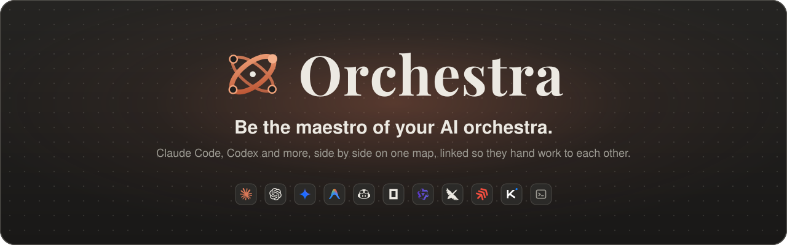
</p>

<p align="center">
  <b>A big canvas where you drop AI coding agents, each in its own real terminal,<br>and wire them together so they hand work to each other.</b><br>
  <sub>Claude Code · Codex · Gemini CLI · Aider · and any CLI you add &nbsp;·&nbsp; <a href="README.fr.md">🇫🇷 Lire en français</a></sub>
</p>

<p align="center">
  <a href="../../releases/latest"></a>
  &nbsp;
  <a href="../../releases/latest"></a>
</p>

<p align="center">
  <a href="#-download"></a>
  <a href="#-whats-new-in-013"></a>
  <a href="#-demos"></a>
  <a href="#-features">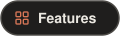</a>
  <a href="#-tutorial"></a>
  <a href="#-keyboard-shortcuts"></a>
  <a href="#-privacy-and-safety"></a>
  <a href="#-faq"></a>
  <a href="#-build-from-source"></a>
</p>

<p align="center">
  <a href="../../releases/latest"></a>
  <a href="../../releases"></a>
  <a href="../../stargazers"></a>
  
  
  <a href="LICENSE"></a>
</p>

<picture>
  <source media="(prefers-color-scheme: light)" srcset="docs/images/map-light.png">
  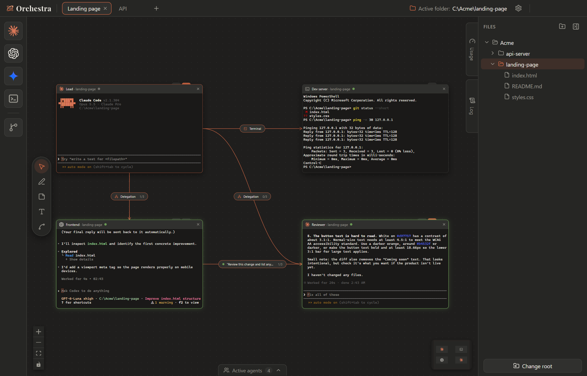
</picture>

> [!NOTE]
> Orchestra is an independent open-source project. It is not affiliated with Anthropic, OpenAI or Google. It only starts the CLIs you already use, with your own accounts, on your machine.

<p align="center"></p>

##  Why Orchestra

You already run Claude Code or Codex in a terminal. Orchestra puts as many of them as you want **side by side on an infinite map**, each one in a real terminal, and lets you **link them**.

<table>
  <tr>
    <td width="33%" align="center" valign="top">
      <br>
      <b>1. Drop your agents</b><br>
      <sub>Pick a folder in the explorer and drag Claude Code, Codex or any CLI onto the map. Each tile is a real terminal.</sub>
    </td>
    <td width="33%" align="center" valign="top">
      <br>
      <b>2. Link them</b><br>
      <sub>Draw a link from one tile to another: relay a finished answer, let a lead delegate, or give an agent a terminal or a shared note.</sub>
    </td>
    <td width="33%" align="center" valign="top">
      <br>
      <b>3. Let them work</b><br>
      <sub>Watch every exchange in the log, answer permissions as they come, and get a glow, a sound and a notification when an agent finishes.</sub>
    </td>
  </tr>
</table>

- A **Lead** agent can **delegate** tasks to other agents and collect their answers by itself.
- A **Frontend** agent can **relay** its finished work to a **Reviewer** automatically.
- An agent can **drive a terminal you can see** (`npm run dev`, tests, builds) instead of running hidden commands.

<p align="center"></p>

##  What's new in 0.1.3

<table>
  <tr>
    <td width="33%" align="center" valign="top">
      <br>
      <b>Tasks: prompt sequences</b><br>
      <sub>Save ordered steps for Claude Code and Codex. Orchestra sends the next prompt when the previous agent finishes, can attach its answer and wait for your approval.</sub>
    </td>
    <td width="33%" align="center" valign="top">
      <br>
      <b>Team templates</b><br>
      <sub>Start a board from <i>Developer + reviewer</i>, <i>Lead + two workers</i> or <i>Developer + terminal</i>, or save your own board as a template.</sub>
    </td>
    <td width="33%" align="center" valign="top">
      <br>
      <b>Blockers inbox and permission notch</b><br>
      <sub>Every waiting permission, refused exchange or stopped terminal in one place. Accept or refuse a simple permission request without opening the tile.</sub>
    </td>
  </tr>
</table>

**Boards**
- **Formations:** select tiles with a right-button rectangle and lay them out as a grid, rows, columns or a line, with a live preview.
- **Groups:** name a set of tiles, move them together, and keep them in team templates.
- **Undo / redo** (`Ctrl+Z` / `Ctrl+Y`) for positions and groups.
- **Find a tile** on every board (`Ctrl+Shift+F`) and **enlarge a terminal** over the whole map (`Ctrl+Shift+M`).
- **Board backups:** up to 10 previous workspaces, and a recovery screen if `workspace.json` can't be read.

**Links and agents**
- **Review before sending** on Relay links: edit, send or discard the prepared message. Queued messages can be cancelled until they are delivered.
- **Exact session resume** for each Claude Code and Codex tile, even when two tiles share a folder.
- **History** tab in Tasks: every message sent through a link, with its reply and the files changed since the task started.
- **Diagnostics** in Settings: where each agent's command was found, its version and its Orchestra hooks.
- A new **first-launch setup**: language, theme, terminal font, grid, glow and dock agents, then the guided tour.

<sub>Full history: <a href="../../releases">releases</a></sub>

<p align="center"></p>

##  Demos

<p align="center">
  <b>Delegation</b><br>
  <sub>A lead Claude asks a Claude and a Codex for an idea, waits for both answers and picks one.</sub><br><br>
  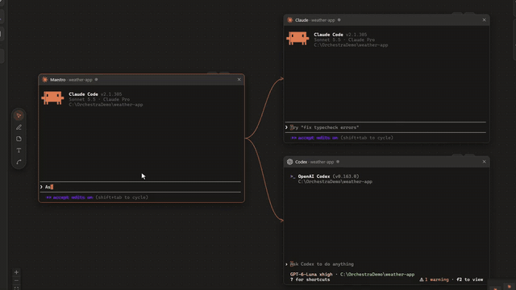
</p>

<table>
  <tr>
    <td width="50%" align="center" valign="top">
      <b>Drop an agent</b><br>
      <sub>Drag it from the dock: it starts in the active folder.</sub><br><br>
      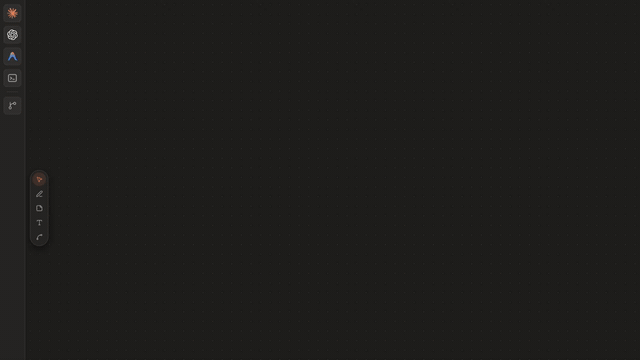
    </td>
    <td width="50%" align="center" valign="top">
      <b>Link two agents</b><br>
      <sub>Link tool, first tile, second tile, then pick the type.</sub><br><br>
      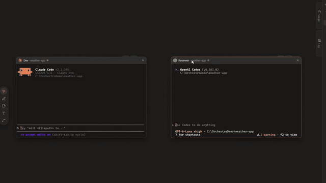
    </td>
  </tr>
  <tr>
    <td width="50%" align="center" valign="top">
      <b>Relay</b><br>
      <sub>When one agent finishes, its answer travels down the link.</sub><br><br>
      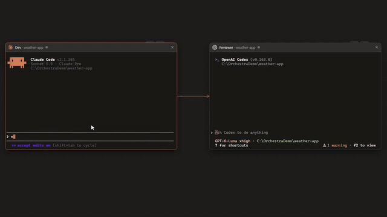
    </td>
    <td width="50%" align="center" valign="top">
      <b>A terminal the agent drives</b><br>
      <sub>It runs the command where you see it, reads the output and can stop it.</sub><br><br>
      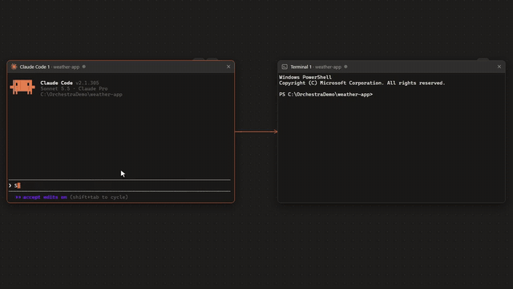
    </td>
  </tr>
  <tr>
    <td width="50%" align="center" valign="top">
      <b>Give a role</b><br>
      <sub>A lasting instruction, given again at every session start.</sub><br><br>
      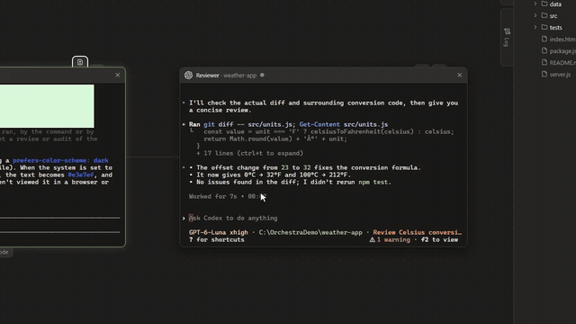
    </td>
    <td width="50%" align="center" valign="top">
      <b>Switch branch</b><br>
      <sub>Drop the Branch square on a tile: the agent moves to its own worktree.</sub><br><br>
      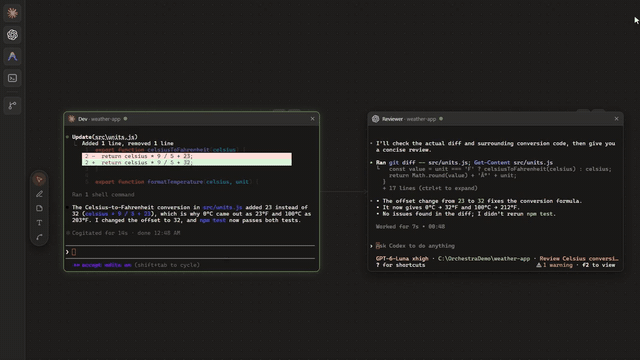
    </td>
  </tr>
</table>

<p align="center"></p>

##  Features

<table>
  <tr>
    <td width="33%" valign="top">&nbsp;<b>Infinite map</b><br><sub>Pan, zoom, minimap, several boards in tabs. Agents keep running in the background.</sub></td>
    <td width="33%" valign="top">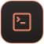&nbsp;<b>Real terminals</b><br><sub>xterm.js + node-pty, started in the folder you picked in the explorer.</sub></td>
    <td width="33%" valign="top">&nbsp;<b>Links between agents</b><br><sub>Relay, Delegation, Terminal and Note links, with turn limits against endless loops.</sub></td>
  </tr>
  <tr>
    <td valign="top">&nbsp;<b>Tasks</b><br><sub>Prompt sequences across agents, plus the history of every exchange.</sub></td>
    <td valign="top">&nbsp;<b>Team templates</b><br><sub>Ready-made teams, or your board saved for next time.</sub></td>
    <td valign="top">&nbsp;<b>Roles</b><br><sub>“You are the reviewer, you never edit files…”, kept across sessions.</sub></td>
  </tr>
  <tr>
    <td valign="top">&nbsp;<b>Exchange log</b><br><sub>Every message, reply, command and refusal, with filters and JSON export.</sub></td>
    <td valign="top">&nbsp;<b>Changes</b><br><sub>Colored diff of the worktree, or since a task started. Open in VS Code.</sub></td>
    <td valign="top">&nbsp;<b>Git branches</b><br><sub>Move an agent to another branch, in its own <code>git worktree</code>.</sub></td>
  </tr>
  <tr>
    <td valign="top">&nbsp;<b>Blockers inbox</b><br><sub>Waiting permissions, refusals and stopped terminals across boards.</sub></td>
    <td valign="top">&nbsp;<b>Status &amp; notifications</b><br><sub>Working, waiting or done, with a glow, a sound and a system notification.</sub></td>
    <td valign="top">&nbsp;<b>Themes</b><br><sub>Standard, Light, ChatGPT, Gemini, VS Code, GitHub, Dracula, Nord, your accent color. English and French.</sub></td>
  </tr>
</table>

<p align="center"></p>

##  Download

<table>
  <tr>
    <td width="50%" align="center" valign="top">
      <b>Windows 10 / 11</b><br>
      <sub>64-bit installer</sub><br><br>
      <a href="../../releases/latest"></a>
      <p align="left">
        ✓ &nbsp;Run <code>Orchestra-Setup-&lt;version&gt;.exe</code><br>
        ✓ &nbsp;Choose the folder, desktop and Start menu shortcuts<br>
        ✓ &nbsp;Built-in update check and installer
      </p>
    </td>
    <td width="50%" align="center" valign="top">
      <b>macOS</b><br>
      <sub>Apple Silicon (<code>arm64</code>) and Intel (<code>x64</code>)</sub><br><br>
      <a href="../../releases/latest"></a>
      <p align="left">
        ✓ &nbsp;Open the <code>.dmg</code> and drag Orchestra to Applications<br>
        ✓ &nbsp;First launch: right-click Orchestra, then <b>Open</b><br>
        ✓ &nbsp;Built-in update check
      </p>
    </td>
  </tr>
</table>

> [!IMPORTANT]
> You need the agent CLIs you want to use, installed and logged in: [`claude`](https://docs.anthropic.com/en/docs/claude-code) and/or [`codex`](https://github.com/openai/codex) must work in a normal terminal.

> [!NOTE]
> The app isn't code-signed yet. On Windows, SmartScreen may say *“Windows protected your PC”*: click **More info → Run anyway**. On macOS, use right-click → **Open** the first time.

<p align="center"></p>

##  Tutorial

### First launch

Orchestra asks a few quick choices (language, theme, terminal font, grid, glow and the agents shown in the dock), then offers a one-minute guided tour on your own board. **Skip** goes straight to the tour. Both can be replayed from **Settings › General**.

<p align="center">
  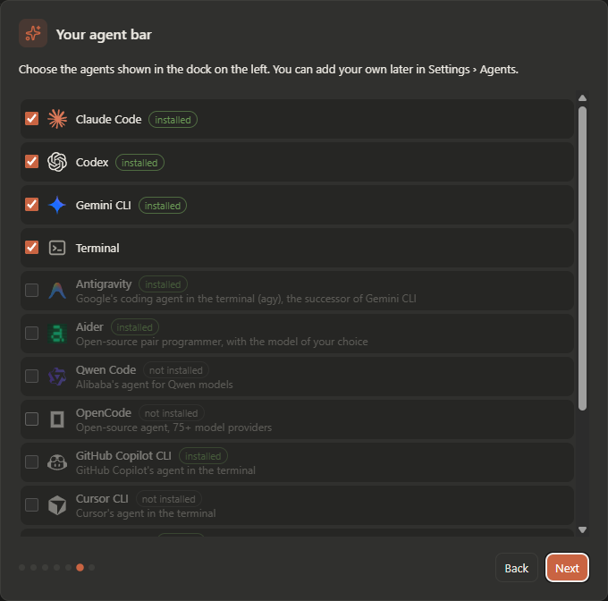
  &nbsp;
  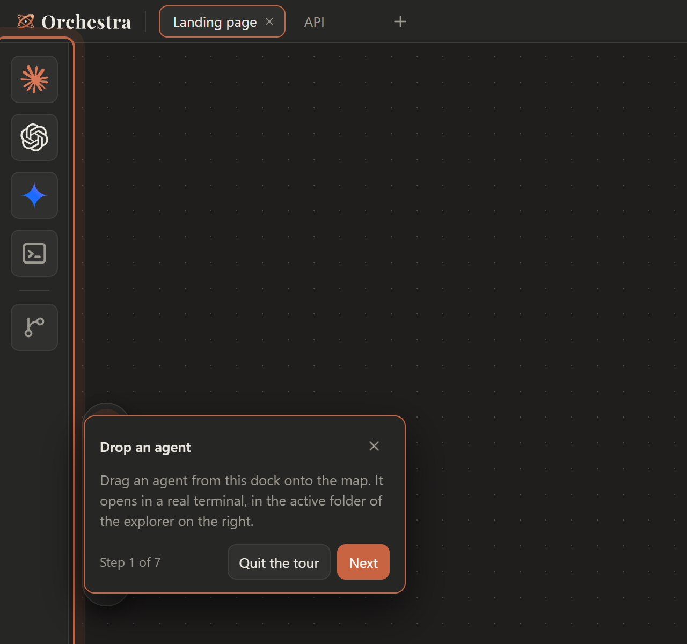
</p>

### 1. Drop your agents

1. In the **file explorer** on the right, click the folder you want to work in: it becomes the *active folder*.
2. **Drag an agent** from the dock on the left onto the map. It starts in a real terminal, in the active folder.
3. Drop a second one. Each tile can be moved, resized (click its title bar first) and renamed (double-click its name).

### 2. Link them

Pick the **Link tool** (`L`), click the first tile, then the second. With the **Select tool** (`V`), click the label in the middle of the link to choose how they talk:

<p align="center">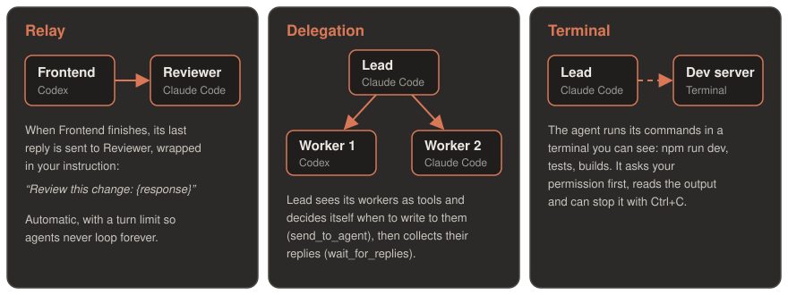</p>

| Link | What happens | Good for |
|---|---|---|
| **Relay** | When A finishes, its last reply is pasted into B with your instruction (`{response}` is replaced by the reply). | Dev → reviewer, writer → translator |
| **Delegation** | A sends a task with a unique ID. Requests to the same agent are queued in order; each reply goes back to its caller. | A lead that splits work between agents |
| **Terminal** | A runs commands in a Terminal tile you can watch, after asking your permission. | Dev servers, tests, builds |
| **Note** | A reads and updates a linked sticky note (`list_notes`, `read_note`, `write_note`). | Shared plans, checklists, findings |

Relay and Delegation links can be reversed or made two-way, and have a **turn limit** (3 by default).

<p align="center">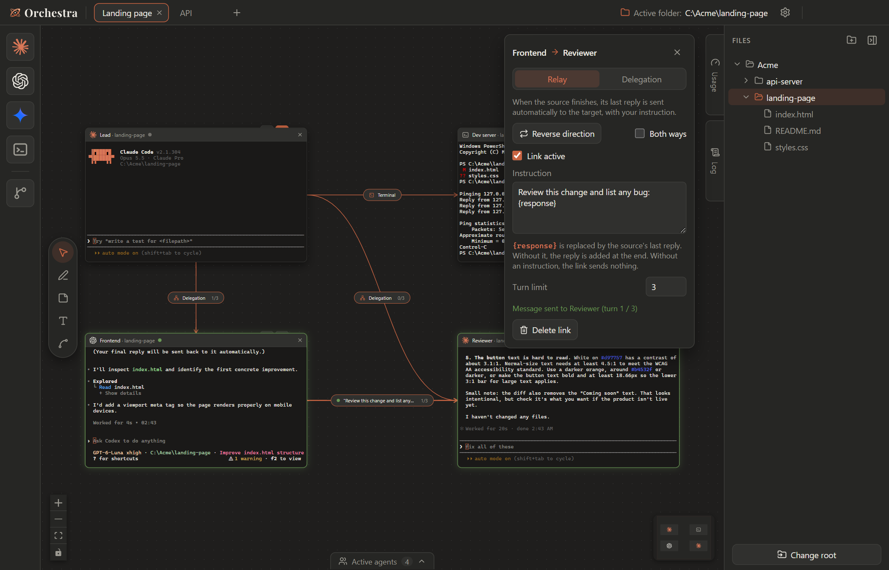</p>

<details>
<summary><b>Review before sending and queued messages</b></summary>

Tick **Review before sending** on a Relay link to stay in control: when the source finishes, the message is prepared but not sent. Edit it, send it or discard it from the link panel or the Log. When the link label is visible, it expands to show a short preview and **Send / Discard** buttons; with several drafts, it shows the oldest first and how many remain.

Queued messages (Relay or Delegation, waiting for a busy target) can be cancelled until they are pasted; a cancelled delegation tells its caller instead of leaving it waiting. A message already delivered cannot be recalled.
</details>

### 3. Give a role

Hover the small tab above a Claude Code or Codex tile and click the **mask**. The role is given to the agent at the start of each session (and again after `/clear`). The editor also shows the text last injected into the current session. A role is an instruction, not a restriction on the agent's tools.

<p align="center">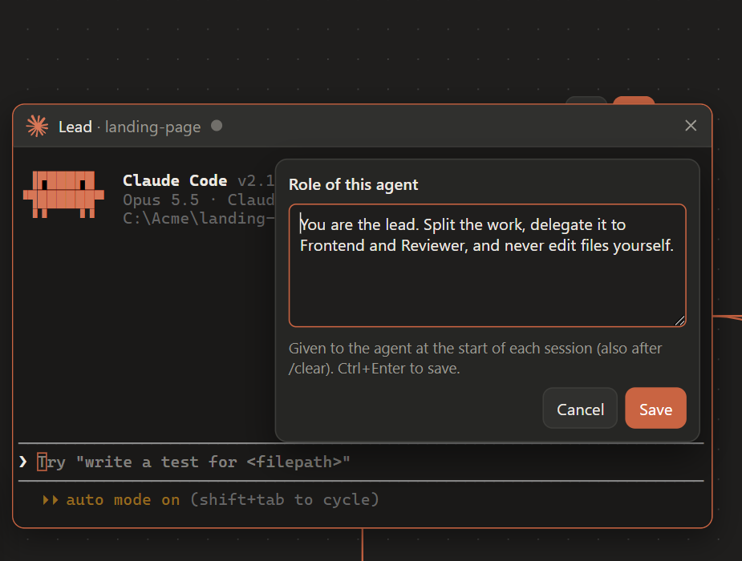</p>

### 4. Share a note

Drop a sticky note and link an agent to it. Ask the agent to read or update it; you see the changes on the map and can edit it yourself. Lines such as `- [ ] To do`, `- [~] In progress` and `- [x] Done` show status icons. A write replaces the whole note, so agents should read it first.

### 5. Follow the exchanges

Open the **Log** on the right edge of the map (`Ctrl+Shift+J`): relayed messages, delegated tasks and their replies, terminal commands and their output, and refusals in red. Each message shows its state (*to review*, *waiting*, *sent*, *reply received*, *cancelled*, *refused*). **Filters** narrow by board, tile and type; click a task ID (`#1a2b3c4d`) to follow one task. **Export log** saves the filtered list as JSON. The log stays in memory only.

<p align="center">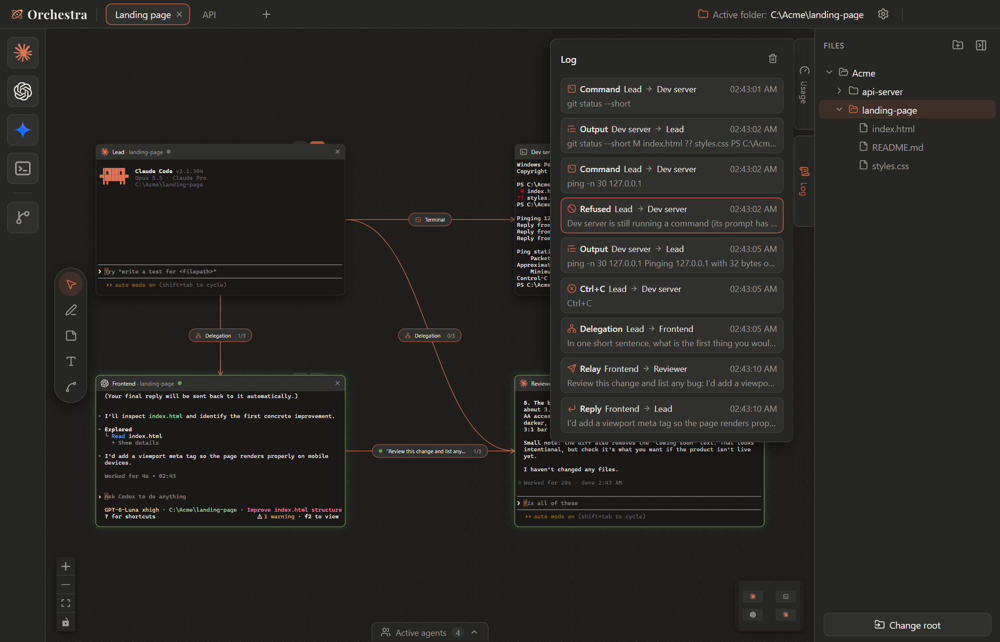</p>

### 6. Answer permissions

When an agent waits for you, a **notch** slides out of the inbox icon in the top bar. For a simple yes/no permission, **Accept** or **Refuse** right there; for a question or a plan, it takes you to the terminal. The **Blockers inbox** also lists refused exchanges, turn limits and stopped terminals across boards.

### 7. Review the changes

When a tile works in a Git repository, a tab above it opens the **Changes** window: every changed file in its worktree with a colored diff, and **Open in VS Code**. Other tiles in the same worktree are listed, since changes in a shared folder can't be attributed to one agent. Orchestra only reads Git here.

<p align="center">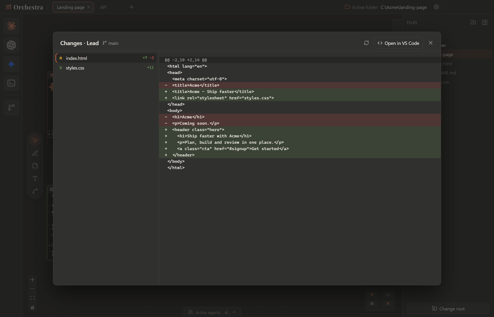</p>

### 8. Resume and recover

Claude Code and Codex resume the exact session saved for each tile. If a saved session is missing, Orchestra asks you to start a new conversation instead of resuming another tile's. **Settings › General › Board backups** keeps up to 10 previous workspaces; if `workspace.json` is unreadable at startup, choose a backup or a new board.

<p align="center"></p>

##  Recipes

**A lead and two workers.** Put a Claude Code *Lead* above a Codex and a Claude Code, linked with **Delegation**. Ask the lead: *“Ask each of your agents for a short poem and tell me which one is best.”* It writes to both, waits for their replies and answers you. (Also available as a team template.)

**Dev + reviewer.** Link a *Frontend* agent to a *Reviewer* with a **Relay** and the instruction *“Review this change and list any bug: {response}”*. Give the reviewer the role *“You never edit files.”* Every time the frontend agent finishes, the reviewer checks its work.

**An agent that runs your dev server.** Link an agent to a **Terminal** tile, then ask: *“Start the dev server in the linked terminal and tell me when it's ready.”* You see the command run; the agent reads the output and can stop it with Ctrl+C.

**A prepared sequence.** Open **Tasks**, create a task with a step for your developer and a step for your reviewer with *Attach the previous response*, then click **Run**. See the [sequence guide](docs/task-sequences.md).

<p align="center">
  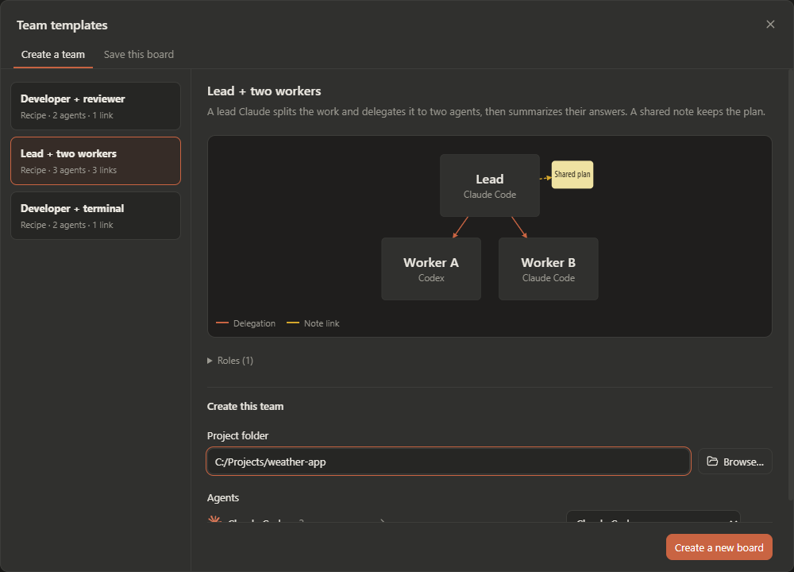
  &nbsp;
  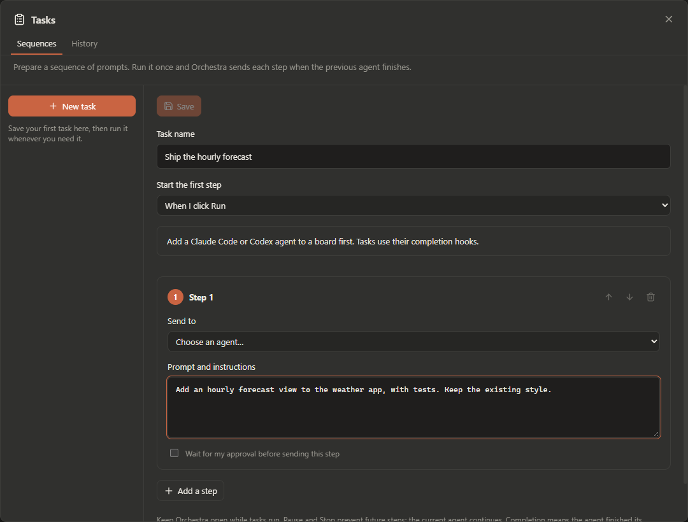
</p>

<details>
<summary><b>More: Tasks, History, Formations, groups and team templates in detail</b></summary>

**Tasks › Sequences.** A task is a saved list of prompts. Orchestra waits for each response before sending the next one, to the same agent or another. Start it on **Run** or when a given agent finishes; a step can attach the previous response or wait for your approval. Pause, resume or stop at any time; the current agent always finishes its answer. Sequences are stored in `task-sequences.json` (50 tasks, 50 steps each).

**Tasks › History.** Every message sent between agents through a link, with its reply and the files changed since the start. Read the reply, then mark the result as done or failed. You can also **Track a task** you give an agent yourself. **Files changed since the start** compares the worktree with a snapshot taken when the work began, without any commit or stash. Snapshots stay local and are bounded (20 references, 500 files each, 200 KB per file).

**Formations and groups.** Select several tiles with a right-button rectangle, then open **Formation**: adaptive grid, 3 or 4 per row, 2 columns, horizontal line or centered column. Hover a formation to preview it; `Ctrl+Z` undoes it. Create a named group from the selection: drag its name to move its members, double-click to rename, or ungroup without closing tiles.

**Team templates.** Choose the project folder and replace any unavailable agent with an installed one, then create a new board. Roles and links are registered before the agents start. Each instance gets fresh tiles and sessions. Saved templates live in `team-templates.json`.

**Top bar.** Tasks, Search, Teams, Inbox and Settings are compact icons. To show their names on hover, turn on **Settings › Appearance › Expand toolbar buttons on hover**.
</details>

<p align="center"></p>

##  Keyboard shortcuts

<table>
  <tr>
    <td width="50%" valign="top">

**Everywhere (even in a terminal)**

| | |
|---|---|
| <kbd>Ctrl</kbd>+<kbd>Tab</kbd> / <kbd>Ctrl</kbd>+<kbd>Shift</kbd>+<kbd>Tab</kbd> | Next / previous board |
| <kbd>Ctrl</kbd>+<kbd>1…9</kbd> | Go to board |
| <kbd>Ctrl</kbd>+<kbd>Shift</kbd>+<kbd>T</kbd> | New board |
| <kbd>Ctrl</kbd>+<kbd>,</kbd> | Settings |
| <kbd>Ctrl</kbd>+<kbd>Shift</kbd>+<kbd>E</kbd> / <kbd>A</kbd> / <kbd>U</kbd> / <kbd>J</kbd> | Files / active agents / usage / log |
| <kbd>Ctrl</kbd>+<kbd>Shift</kbd>+<kbd>F</kbd> | Find a tile on every board |
| <kbd>Ctrl</kbd>+<kbd>Shift</kbd>+<kbd>M</kbd> | Enlarge or restore the selected terminal |

</td>
    <td width="50%" valign="top">

**On the map**

| | |
|---|---|
| <kbd>V</kbd> <kbd>P</kbd> <kbd>N</kbd> <kbd>T</kbd> <kbd>L</kbd> | Select, pen, sticky note, text, link |
| <kbd>F</kbd> | Fit everything in view |
| <kbd>Del</kbd> | Delete the selection (with confirmation) |
| <kbd>F2</kbd> | Rename the selected tile |
| <kbd>Ctrl</kbd>+<kbd>Z</kbd> / <kbd>Ctrl</kbd>+<kbd>Y</kbd> | Undo / redo |

</td>
  </tr>
</table>

In a terminal, <kbd>Ctrl</kbd>+<kbd>C</kbd> copies when text is selected (otherwise it interrupts) and <kbd>Ctrl</kbd>+<kbd>V</kbd> pastes. The full list is in **Settings › Shortcuts**.

<p align="center">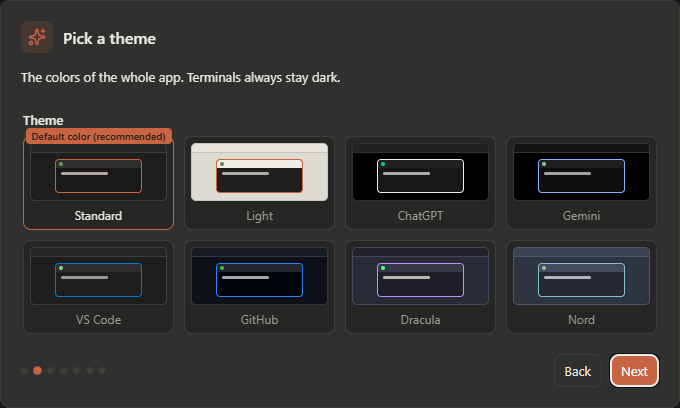</p>

<p align="center"></p>

##  Privacy and safety

<table>
  <tr>
    <td width="50%" valign="top">
      <b>🔒 Local orchestration</b><br>
      <sub>Agents talk to Orchestra through a small server bound to <code>127.0.0.1</code>, protected by a secret token that changes at every launch. Update checks contact GitHub (can be turned off in Settings › General). Git fetches and the agent CLIs use their own connections.</sub>
    </td>
    <td width="50%" valign="top">
      <b>✋ Your permissions stay yours</b><br>
      <sub>Orchestra never approves a permission on its own. Its own tools are pre-approved, except <code>run_in_terminal</code>, which always asks. The notch only sends your Accept or Refuse.</sub>
    </td>
  </tr>
  <tr>
    <td valign="top">
      <b>🌿 Git, read-mostly</b><br>
      <sub>Only <code>git fetch</code>, <code>git worktree add</code> (when you pick a branch) and read-only commands. Orchestra never commits or pushes.</sub>
    </td>
    <td valign="top">
      <b>📁 What it writes outside its folder</b><br>
      <sub><code>~/.claude.json</code>: marks a folder as trusted before launching Claude Code (can be turned off). <code>~/.codex/orchestra.config.toml</code> and Orchestra's entries in <code>~/.codex/hooks.json</code>, inactive outside Orchestra.</sub>
    </td>
  </tr>
</table>

App data (settings, boards, tasks, templates) lives in `%APPDATA%\Orchestra` (macOS: `~/Library/Application Support/Orchestra`). The exchange log and the blockers inbox stay in memory only.

<p align="center"></p>

##  FAQ

<details>
<summary><b>Codex asks me to approve “5 hooks”</b></summary>

That's Orchestra's status hooks (working / done). Choose **Trust all and continue** once; Codex remembers it.
</details>

<details>
<summary><b>Which agents can use links?</b></summary>

Claude Code and Codex can relay, delegate, drive a terminal, use linked notes and run task sequences. Other CLIs (Aider, Gemini CLI, your own…) work in a tile and can *receive* relayed messages; their integration does not include Orchestra hooks or orchestration tools.
</details>

<details>
<summary><b>Can I add another CLI?</b></summary>

Yes: **Settings › Agents**. Pick a known agent (Google Antigravity, Aider, Qwen Code, OpenCode, GitHub Copilot CLI, Cursor CLI, Goose, Amp, Kimi CLI…) or add your own command, logo and color. *Test* checks that the command exists, and **Settings › Diagnostics** shows where it was found.
</details>

<details>
<summary><b>An agent seems stuck</b></summary>

Look at the inbox icon in the top bar: the agent may be waiting for a permission or an answer. The Blockers inbox also shows turn limits reached and refused exchanges. **Settings › Diagnostics** tells you whether the agent has Orchestra hooks and which hook it sent last.
</details>

<details>
<summary><b>Linux?</b></summary>

Orchestra runs on Windows and macOS (Apple Silicon and Intel), with an installer for each in every release. Linux is not tested or packaged yet.
</details>

<p align="center"></p>

##  Build from source

Use Node.js 22.12+. Install the locked dependencies with `npm ci`.

```bash
npm ci           # node-pty ships prebuilt binaries: no Visual Studio or Python needed
npm run dev      # Vite + Electron with hot reload
npm test         # session, recovery, queue, review, undo and diagnostics tests
npm run dist     # Windows installer in release/Orchestra-Setup-<version>.exe
```

The macOS version lives on the `macbook` branch: `npm run dist:mac` there builds the `.dmg` files (on a Mac), and every push to that branch builds them on GitHub Actions.

<details>
<summary><b>Windows launcher and build notes</b></summary>

`launcher.exe` at the root rebuilds the interface and prepares a local `Orchestra.exe` with Orchestra's icon and product metadata (`npm run build:launcher` recompiles the launcher; `npm run build:runtime` prepares the runtime). The original Electron executable stays unchanged. The branded copy adds about 250 MB under ignored `node_modules` and is reused until Electron, the icon or the version changes. Close the app before applying a runtime update.

If Windows' ransomware protection (*Controlled folder access*) is on and the project is in `Documents`, it may block the installer build: allow `makensis.exe` or build elsewhere.
</details>

<details>
<summary><b>Project structure</b></summary>

```
electron/            Node side: windows, terminals, files, local server, MCP
  main.cjs           window, IPC routes, notifications
  preload.cjs        the only bridge to the UI (window.pty, fs, settings, workspace, git…)
  ptyManager.cjs     one real PTY per tile
  hookServer.cjs     local server (127.0.0.1 + token) for agent hooks and MCP tools
  mcpServer.cjs      the "orchestra" MCP server started by each agent (stdio)
  linkRelay.cjs      Relay links
  delegation.cjs     Delegation links (list_agents, send_to_agent, wait_for_replies)
  terminalLink.cjs   Terminal links (run_in_terminal, read_terminal, interrupt_terminal)
  activityLog.cjs    exchange log (memory only)
  agentStatus.cjs    tile status and permission requests
  claudeHooks.cjs    per-tile Claude Code settings and MCP config
  codexProfile.cjs   Codex profile and hooks
  git.cjs            branches, worktrees, read-only changes and diffs
src/                 React interface (map, tiles, panels, settings, tutorial)
docs/images/         README images, demos and artwork
```

The path of a keystroke: xterm.js → `window.pty.write` → IPC → node-pty → the CLI, and back through `pty:data:<id>`.
</details>

<p align="center"></p>

##  Feedback & support

<p align="center">
  <b>Found a bug or have an idea?</b><br>
  <a href="../../issues/new/choose">Open an issue</a> (a short form for bugs, one for feature requests) or share how you use Orchestra in <a href="../../discussions">Discussions</a>.<br>
  <sub>For anything else: <b>orchestraboardai [at] gmail [dot] com</b></sub>
</p>

<p align="center">
  If Orchestra saves you time, a ⭐ on the repository helps other people find it.
</p>

##  License

[MIT](LICENSE) © 2026 Dimitri ([@Adoraay](https://github.com/Adoraay))
